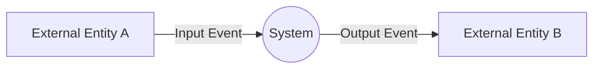

# System Context Diagram

## Notation
- Process: Circle representing the entire system.
- Terminator: Rectangle representing an external entity.
- Flow: Directed arrow representing an input or output.
- Flow Label: Exact event name from the Event List.

## Mermaid Format

Use a Mermaid flowchart with left-to-right direction.

## Formatting Rules
- Use Mermaid flowchart LR.
- Use (( )) for the system process.
- Use [ ] for external entities.
- Use --> for data flows.
- Use -.-> for control events (interrupt-driven inputs such as Front Sensor Input, and Tick).
- Use |Event Name| for arrow labels.
- Every arrow label must match an Event List entry.
- Do not represent internal system components.
- Do not include unlabeled arrows.
- The diagram must contain exactly one system process.
