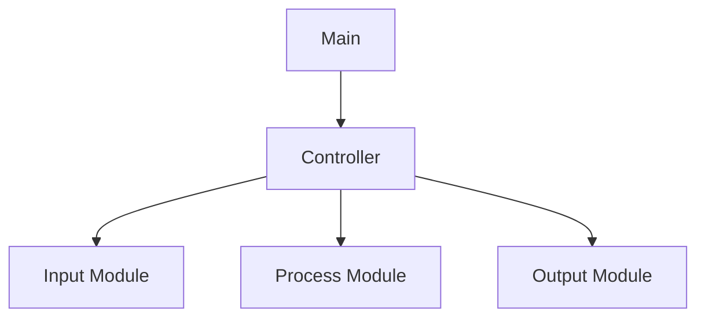

# Structure Chart

## 1. Objective
Represent the hierarchical software module structure
derived from Transform Analysis and SA artifacts.

## 2. Notation

| Element | Mermaid Representation |
|---|---|
| Module | Rectangle [ ] |
| Library Module | Subroutine [[ ]] |
| Module Call | Directed arrow --> |
| Data Information | Labeled dotted arrow |
| Control Information | Labeled dashed arrow |
| Decision | Diamond { } |
| Iteration | Repeated-call annotation |

Note:
Mermaid approximates traditional Structure Chart
notations. Explicit labels must distinguish
module calls, data, and control information.

## 3. Module Hierarchy

Use Mermaid flowchart TB.

## 4. Module Descriptions

| Module | Responsibility | Called Modules |
|---|---|---|
| | | |

## 5. Module Interfaces

| Caller | Callee | Input Data | Output Data | Control Information |
|---|---|---|---|---|
| | | | | |

## 6. SA-to-SD Traceability

| SA Process ID | SA Process Name | SD Module | Design Rationale |
|---|---|---|---|
| | | | |

## 8. Design Validation
- Every required SA function is implemented
  by at least one design module.
- Every module has a clear responsibility.
- Module calls represent actual invocation.
- Data and control information are distinguishable.
- Module interfaces are consistent.
- Controller calls are consistent with the FSM.
- Avoid unnecessary coupling.
- Maintain high internal cohesion.
- Do not invent unsupported modules or behavior.
