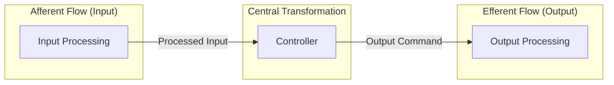

# Transform Analysis

## 1. Objective
Identify the Afferent Flow, Central Transformation,
and Efferent Flow from the approved DFD hierarchy.

## 2. Transform Regions

### Afferent Flow (Input)
Identify processes responsible for receiving
and preparing input data.

| Process ID | Process Name | Input | Output |
|---|---|---|---|
| | | | |

### Central Transformation (Process)
Identify processes responsible for central
processing, decision-making, and control.

| Process ID | Process Name | Input | Output |
|---|---|---|---|
| | | | |

### Efferent Flow (Output)
Identify processes responsible for producing
and delivering system outputs.

| Process ID | Process Name | Input | Output |
|---|---|---|---|
| | | | |

## 3. Transform Boundaries
- Afferent-to-Central Boundary:
- Central-to-Efferent Boundary:
- Boundary Data Flows:
- Boundary Control Flows:

Explain the rationale for each boundary.

## 4. Transform Analysis Diagram

Represent the regions using Mermaid.

## 5. Analysis Rules
- Identify transform regions from actual DFD processes.
- Preserve process names and identifiers.
- Distinguish data flows from control flows.
- Identify boundaries using actual DFD connections.
- Do not introduce unsupported processes.
- Do not confuse data flow with module calls.
- Explain the rationale for each classification.
