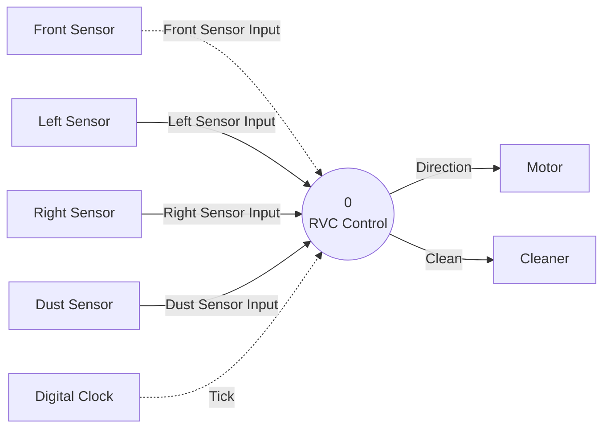

# DFD Level 0: RVC Control

Sources: `preliminary_requirements.md` (R1–R7), `clarifications.md` (C1–C28), `artifacts/SA/event_list.md`, `artifacts/SA/context_diagram.md`.

## Purpose
Level 0 shows the whole system as one process, **0 RVC Control**, with the same external entities and flows as the System Context Diagram. It is the root of the functional decomposition. It has no internal processes or data stores.

## Notation

| Element | Mermaid Representation |
|---|---|
| Data Process | Circular node `(( ))` |
| Terminator | Rectangle `[ ]` |
| Data Flow | Solid arrow `-->` |
| Control Flow | Dashed arrow `-.->` |

## Diagram

## Process

| No. | Name | Type | Function | Reference |
|---|---|---|---|---|
| 0 | RVC Control | Data process (whole system) | Reads the obstacle and dust sensors, paced by the clock, and sends the movement direction to the Motor and the cleaning mode to the Cleaner. It drives forward with cleaning, avoids obstacles by turning or reversing, and powers up cleaning when dust is found. | R1–R5, R7, C1–C28 |

## Flows

| Flow | Type | Source | Destination | Values | Reference |
|---|---|---|---|---|---|
| Front Sensor Input | Control (interrupt) | Front Sensor | 0 RVC Control | true / false | R3, R4, C1, C3 |
| Left Sensor Input | Data (periodic) | Left Sensor | 0 RVC Control | true / false | R3, R4, C2, C3 |
| Right Sensor Input | Data (periodic) | Right Sensor | 0 RVC Control | true / false | R3, R4, C2, C3 |
| Dust Sensor Input | Data (periodic) | Dust Sensor | 0 RVC Control | true / false | R5, C2, C3 |
| Tick | Control (temporal) | Digital Clock | 0 RVC Control | periodic signal | C2, C5, C6, C9 |
| Direction | Data (output command) | 0 RVC Control | Motor | Forward / Backward / Turn Left / Turn Right | R2–R4, C4, C5, C9, C12, C16, C22, C27 |
| Clean | Data (output command) | 0 RVC Control | Cleaner | clean_off / clean_on / clean_up | R1, R3, R5, C6–C8, C11, C12, C16, C22, C27, C28 |

## Data Stores
None at Level 0. Any stored data (for example, latched sensor values or tick counters) is internal to Process 0 and will be shown at lower levels if needed.

## Balancing with the System Context Diagram

| Context Diagram Flow | Direction | Style | Level 0 Flow | Style | Balanced |
|---|---|---|---|---|---|
| Front Sensor Input | In | Dashed (control) | Front Sensor Input | Dashed (control) | Yes |
| Left Sensor Input | In | Solid (data) | Left Sensor Input | Solid (data) | Yes |
| Right Sensor Input | In | Solid (data) | Right Sensor Input | Solid (data) | Yes |
| Dust Sensor Input | In | Solid (data) | Dust Sensor Input | Solid (data) | Yes |
| Tick | In | Dashed (control) | Tick | Dashed (control) | Yes |
| Direction | Out | Solid (data) | Direction | Solid (data) | Yes |
| Clean | Out | Solid (data) | Clean | Solid (data) | Yes |

- **Inputs:** 5 in the Context Diagram, 5 at Level 0. Same names, sources and styles.
- **Outputs:** 2 in the Context Diagram, 2 at Level 0. Same names, destinations and styles.
- **External entities:** The same 8 terminators. None added or removed.
- **Unexplained flows:** None.
- **Result:** Level 0 is balanced with the System Context Diagram.

## Notes and Issues

1. **Process name. Resolved.** The Context Diagram (Rev 2) now also calls the system process "RVC Control", matching "0 RVC Control" here.
2. **Event List citations. Resolved.** The Event List and Context Diagram (Rev 2) now cite C1–C20 and mark their resolved Open Issues. C9 answers Event List Open Issues 1 and 2, and C10 answers Open Issue 4. C11 (an obstacle cancels the power-up) and C12 (Direction and Clean are sent only on change) add rules. None of them changes the external interface, so Level 0 is unaffected.
3. **Former open issues. Resolved (C13, C14, C17).** Side-only obstacles cause no reaction (C13). Dust during an active clean_up does not restart it (C14). A tick is an abstract unit, and left, right and dust are sampled once per tick (C17). C15, C16 and C18–C20 refine the behaviour further. None of them affects Level 0; they are applied in Process 0's specification and at lower levels.
4. **C21–C28. Resolved.** Re-checked in the SA consistency pass. C21 and C23 set the start-up values of the stored sensor data (Level 2). C22 and C27 state that Direction = Forward and Clean = clean_on are sent once at start-up, produced through the Level 3 Controller. C24–C26 define the Level 3 control signals. C28 states that a power-up ends with a return to clean_on and that later dust starts a new power-up. None of them changes the external interface, so Level 0 is unaffected.
