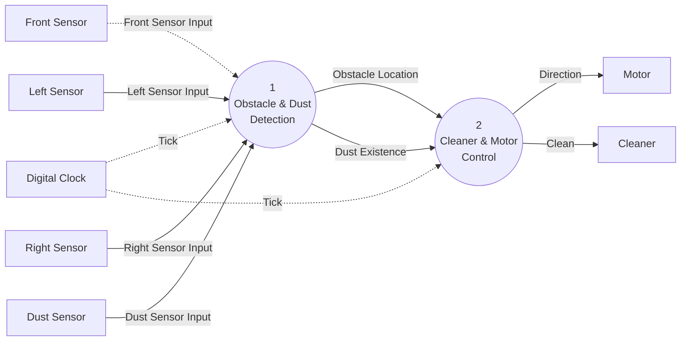

# DFD Level 1: RVC Control Decomposition

Sources: `preliminary_requirements.md` (R1–R7), `clarifications.md` (C1–C28), `artifacts/SA/event_list.md`, `artifacts/SA/context_diagram.md`, `artifacts/SA/data_dictionary.md`, `artifacts/SA/DFD/dfd_level_0.md`, `artifacts/SA/process_specification.md`.

## Purpose
Level 1 splits **0 RVC Control** into its two major functions, following the reference decomposition in the `sa-dfd` skill:

- **1 Obstacle & Dust Detection** reads the four sensors and works out where obstacles are and whether dust is present.
- **2 Cleaner & Motor Control** uses those results to decide and send the movement direction and the cleaning mode.

This separates sensing from deciding and acting. The external interface of Process 0 is unchanged.

## Notation

| Element | Mermaid Representation |
|---|---|
| Data Process | Circular node `(( ))` |
| Control Process | Dashed circular node (none at this level) |
| Terminator | Rectangle `[ ]` |
| Data Store | Subroutine node `[[ ]]` (none at this level) |
| Data Flow | Solid arrow `-->` |
| Control Flow | Dashed arrow `-.->` |

## Diagram

## Processes

| No. | Name | Type | Function | Inputs | Outputs | Reference |
|---|---|---|---|---|---|---|
| 1 | Obstacle & Dust Detection | Data process | Receives the front sensor interrupt and samples the left, right and dust sensors on each tick. Produces where obstacles are (front, left, right) and whether dust is present. | Front Sensor Input, Left Sensor Input, Right Sensor Input, Dust Sensor Input, Tick | Obstacle Location, Dust Existence | R3, R4, R5, C1, C2, C3, C17, C19, C20, C21, C23 |
| 2 | Cleaner & Motor Control | Data process | Decides the movement direction and cleaning mode from Obstacle Location and Dust Existence. Times the 3-tick rotation, the reversing of at least 3 ticks and the 3-tick power-up. Sends Direction and Clean only when they change. | Obstacle Location, Dust Existence, Tick | Direction, Clean | R1–R5, C4–C16, C18, C20, C22, C27, C28 |

## Flows

### External flows (preserved from Level 0)

| Flow | Type | Source | Destination | Values | Reference |
|---|---|---|---|---|---|
| Front Sensor Input | Control (interrupt) | Front Sensor | 1 Obstacle & Dust Detection | true / false | R3, R4, C1, C3 |
| Left Sensor Input | Data (periodic) | Left Sensor | 1 Obstacle & Dust Detection | true / false | R3, R4, C2, C3 |
| Right Sensor Input | Data (periodic) | Right Sensor | 1 Obstacle & Dust Detection | true / false | R3, R4, C2, C3 |
| Dust Sensor Input | Data (periodic) | Dust Sensor | 1 Obstacle & Dust Detection | true / false | R5, C2, C3 |
| Tick | Control (temporal) | Digital Clock | 1 Obstacle & Dust Detection, 2 Cleaner & Motor Control | periodic signal | C2, C5, C6, C9 |
| Direction | Data (output command) | 2 Cleaner & Motor Control | Motor | Forward / Backward / Turn Left / Turn Right | R2–R4, C4, C5, C9, C12, C16, C22, C27 |
| Clean | Data (output command) | 2 Cleaner & Motor Control | Cleaner | clean_off / clean_on / clean_up | R1, R3, R5, C6–C8, C11, C12, C16, C22, C27, C28 |

### Internal flows (new at Level 1)

| Flow | Type | Source | Destination | Composition / Values | Reference |
|---|---|---|---|---|---|
| Obstacle Location | Data | 1 Obstacle & Dust Detection | 2 Cleaner & Motor Control | Front Obstacle + Left Obstacle + Right Obstacle (each Boolean). The front part is updated as soon as the front interrupt arrives (C1). The left and right parts are updated on each tick (C2). | R3, R4, C1–C4 |
| Dust Existence | Data | 1 Obstacle & Dust Detection | 2 Cleaner & Motor Control | Boolean. true = dust detected at the latest sample. Updated on each tick (C2). | R5, C2, C3, C10 |

## Data Stores
None at Level 1. The sensing results go directly from Process 1 to Process 2 as flows. Process 2 keeps its current direction, cleaning mode and tick counters internally. These are refined at Levels 2–3. A data store will be added only if a lower level needs one shared between processes.

## Balancing with DFD Level 0

| Level 0 Flow (Process 0) | Direction | Style | Level 1 Flow | Style | Level 1 Endpoint | Balanced |
|---|---|---|---|---|---|---|
| Front Sensor Input | In | Dashed (control) | Front Sensor Input | Dashed (control) | → 1 | Yes |
| Left Sensor Input | In | Solid (data) | Left Sensor Input | Solid (data) | → 1 | Yes |
| Right Sensor Input | In | Solid (data) | Right Sensor Input | Solid (data) | → 1 | Yes |
| Dust Sensor Input | In | Solid (data) | Dust Sensor Input | Solid (data) | → 1 | Yes |
| Tick | In | Dashed (control) | Tick | Dashed (control) | → 1 and → 2 (same flow, split) | Yes |
| Direction | Out | Solid (data) | Direction | Solid (data) | 2 → | Yes |
| Clean | Out | Solid (data) | Clean | Solid (data) | 2 → | Yes |

- **Inputs:** 5 at Level 0, 5 at Level 1. Same names, sources and styles.
- **Outputs:** 2 at Level 0, 2 at Level 1. Same names, destinations and styles.
- **Flow split:** Tick goes to both processes. Process 1 uses it to sample the periodic sensors (C2). Process 2 uses it to time the 3-tick durations (C5, C6, C9). It is the same Level 0 flow drawn twice, not a new external flow.
- **Internal flows:** Obstacle Location and Dust Existence are new and stay inside the Process 0 boundary. They do not appear at Level 0.
- **External entities:** The same 8 terminators. None added or removed.
- **Unexplained external flows:** None.
- **Result:** Level 1 is balanced with Level 0.

## Traceability to the Process 0 Specification

| Process 0 logic (`process_specification.md`) | Level 1 process |
|---|---|
| Receive front interrupt; sample left, right, dust on each tick (C1, C2) | 1 Obstacle & Dust Detection |
| Choose Turn Left / Turn Right / Backward (R3, R4, C4, C9) | 2 Cleaner & Motor Control |
| Time rotation, reversing and power-up (C5, C6, C9) | 2 Cleaner & Motor Control |
| Set clean_off / clean_on / clean_up; cancel power-up on obstacle; ignore dust while turning or reversing (C7, C8, C10, C11) | 2 Cleaner & Motor Control |
| Send Direction and Clean only on change (C12) | 2 Cleaner & Motor Control |

## Notes and Issues

1. **Interrupt carried through a data flow. Resolved (C20).** Front Sensor Input is a control flow (interrupt) into Process 1. Its result reaches Process 2 inside the data flow Obstacle Location. Process 1 updates the front part of Obstacle Location as soon as the interrupt arrives (C1, C20). Process 2 acts on it at the next Tick, after that tick's sensing (C20). A front interrupt during a turn or reverse is not acted on (C15), and Front = false only updates Obstacle Location (C19). No separate control flow from Process 1 to Process 2 is needed. At Level 2, Obstacle Location becomes a data store that 2.1 Main Control reads on Tick. *(Revised: the earlier text said Process 2 reacts straight away, not at the next tick, which conflicted with C20.)*
2. **Composite flow.** Obstacle Location combines three Boolean parts. At Level 2 it is produced by 1.5 Determine Obstacle Location. The Data Dictionary should define it as `Front Obstacle + Left Obstacle + Right Obstacle`.
3. **Open issues carried forward. All resolved** (from `process_specification.md`; they do not change Level 1). Re-checked against C1–C28:
   - reaction to a side-only obstacle with the front clear: **Resolved (C13)**, no reaction;
   - whether repeated dust during clean_up restarts the 3-tick period: **Resolved (C14)**, it does not;
   - a front obstacle reported while turning or reversing: **Resolved (C15)**, not acted on, and a new turn decision is made if the front is still blocked when a turn ends;
   - initial outputs at start-up: **Resolved (C16, C22, C27)**, Direction = Forward and Clean = clean_on are sent once at start-up and only on change after that. At Level 3 they come from the Controller's start-up Enable "Move Forward" and Trigger "Clean Normal", with no separate start-up send;
   - the tick period and sampling rate: **Resolved (C17)**, an abstract tick, sampled once per tick;
   - initial stored sensor values: **Resolved (C21, C23)**, all false; left, right and dust are overwritten on the first tick;
   - dust on the tick a power-up ends: **Resolved (C28)**, the RVC returns to clean_on on that tick, and dust on a later tick starts a new power-up (not a restart under C14).

   These rules are applied in the Process 2 specification and will shape the Controller at Levels 3 and 4.
4. **Follow-up artifacts. Done.** The Data Dictionary (Rev 3) and Process Specifications (Rev 2) added these. Original note: the Data Dictionary should now get Obstacle Location and Dust Existence, and the Process Specifications should get Processes 1 and 2 (`/sa-data-dictionary`, `/sa-process-specification`).
