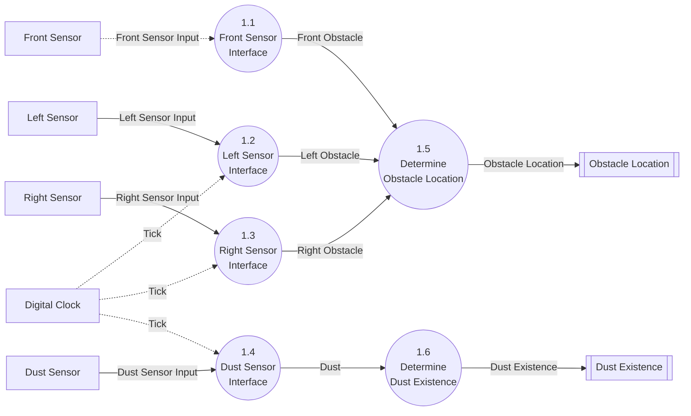
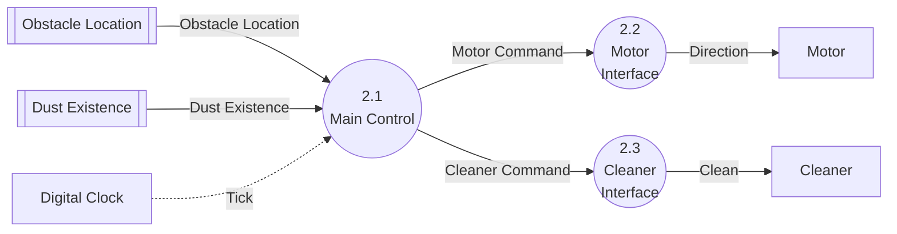

# DFD Level 2: Decomposition of Processes 1 and 2

Sources: `preliminary_requirements.md` (R1–R7), `clarifications.md` (C1–C28), `artifacts/SA/event_list.md`, `artifacts/SA/context_diagram.md`, `artifacts/SA/data_dictionary.md` (generated from Rev 3; text re-checked against Rev 8), `artifacts/SA/DFD/dfd_level_0.md`, `artifacts/SA/DFD/dfd_level_1.md`, `artifacts/SA/process_specification.md` (generated from Rev 2; text re-checked against Rev 7).

## Purpose
Level 2 refines both Level 1 processes, following the reference decomposition in the `sa-dfd` skill. Each parent has its own diagram.

- **Process 1 Obstacle & Dust Detection** splits into one interface process per sensor (1.1–1.4) and two processes that work out the results (1.5, 1.6). The results are now kept in two data stores, **Obstacle Location** and **Dust Existence**.
- **Process 2 Cleaner & Motor Control** splits into the decision logic (2.1 Main Control) and one interface process per actuator (2.2 Motor Interface, 2.3 Cleaner Interface). The interfaces apply C12: they send a value only when it changes.

Data stores are introduced because the two sensing results are written and read at different times. The front part of Obstacle Location is written as soon as the interrupt arrives (C1, C20). Left, right and dust are written once per tick (C2, C17). Main Control reads the latest stored values on Tick (C18, C20).

## Notation

| Element | Mermaid Representation |
|---|---|
| Data Process | Circular node `(( ))` |
| Control Process | Dashed circular node (none at this level; the Controller appears at Level 3) |
| Terminator | Rectangle `[ ]` |
| Data Store | Subroutine node `[[ ]]` |
| Data Flow | Solid arrow `-->` |
| Control Flow | Dashed arrow `-.->` |

---

## Diagram 1: Process 1 Obstacle & Dust Detection

### Processes (Diagram 1)

| No. | Name | Type | Function | Inputs | Outputs | Reference |
|---|---|---|---|---|---|---|
| 1.1 | Front Sensor Interface | Data process | Receives the front sensor interrupt and passes its value on straight away as Front Obstacle. A value of false is passed on too; it only updates the stored location (C19). | Front Sensor Input | Front Obstacle | R3, R4, C1, C3, C19, C20 |
| 1.2 | Left Sensor Interface | Data process | On each Tick, samples the left sensor once and passes the value on as Left Obstacle. | Left Sensor Input, Tick | Left Obstacle | R3, R4, C2, C3, C17 |
| 1.3 | Right Sensor Interface | Data process | On each Tick, samples the right sensor once and passes the value on as Right Obstacle. | Right Sensor Input, Tick | Right Obstacle | R3, R4, C2, C3, C17 |
| 1.4 | Dust Sensor Interface | Data process | On each Tick, samples the dust sensor once and passes the value on as Dust. | Dust Sensor Input, Tick | Dust | R5, C2, C3, C17 |
| 1.5 | Determine Obstacle Location | Data process | Combines the latest Front, Left and Right Obstacle values and writes them to the Obstacle Location store. It updates only the part that has just arrived and keeps the other parts unchanged. | Front Obstacle, Left Obstacle, Right Obstacle | Obstacle Location (to store) | R3, R4, C1–C4, C18, C20 |
| 1.6 | Determine Dust Existence | Data process | Writes the latest Dust value to the Dust Existence store. | Dust | Dust Existence (to store) | R5, C2, C3 |

### Flows (Diagram 1)

| Flow | Type | Source | Destination | Composition / Values | Reference |
|---|---|---|---|---|---|
| Front Sensor Input | Control (interrupt) | Front Sensor | 1.1 | true / false | R3, R4, C1, C3 |
| Left Sensor Input | Data (periodic) | Left Sensor | 1.2 | true / false | R3, R4, C2, C3 |
| Right Sensor Input | Data (periodic) | Right Sensor | 1.3 | true / false | R3, R4, C2, C3 |
| Dust Sensor Input | Data (periodic) | Dust Sensor | 1.4 | true / false | R5, C2, C3 |
| Tick | Control (temporal) | Digital Clock | 1.2, 1.3, 1.4 | occurrence only | C2, C17 |
| Front Obstacle | Data (internal) | 1.1 | 1.5 | Boolean. Arrives as soon as the interrupt is raised. | R3, R4, C1, C20 |
| Left Obstacle | Data (internal) | 1.2 | 1.5 | Boolean. Arrives once per tick. | R3, R4, C2, C17 |
| Right Obstacle | Data (internal) | 1.3 | 1.5 | Boolean. Arrives once per tick. | R3, R4, C2, C17 |
| Dust | Data (internal, new) | 1.4 | 1.6 | Boolean. Arrives once per tick. | R5, C2, C17 |
| Obstacle Location | Data (store write) | 1.5 | Obstacle Location store | Front Obstacle + Left Obstacle + Right Obstacle | R3, R4, C1–C4 |
| Dust Existence | Data (store write) | 1.6 | Dust Existence store | Boolean | R5, C2, C3 |

---

## Diagram 2: Process 2 Cleaner & Motor Control

### Processes (Diagram 2)

| No. | Name | Type | Function | Inputs | Outputs | Reference |
|---|---|---|---|---|---|---|
| 2.1 | Main Control | Data process (decomposed into the Controller and actions at Level 3) | On each Tick, after the sensing of that tick, reads Obstacle Location and Dust Existence from the stores. Decides the movement and cleaning mode: forward with clean_on, turn or reverse on a front obstacle, power-up on dust. Times the 3-tick turn, the reverse of at least 3 ticks and the 3-tick power-up; when a power-up ends it returns to clean_on on that tick (C28). Issues Motor Command = Forward and Cleaner Command = clean_on once at start-up (C27). After that it issues Motor Command and Cleaner Command only when it decides a new movement or cleaning mode, that is, on a state transition (C26). | Obstacle Location (from store), Dust Existence (from store), Tick | Motor Command, Cleaner Command | R1–R5, C4–C11, C13–C16, C18–C20, C26–C28 |
| 2.2 | Motor Interface | Data process | Sends Direction to the Motor only when the commanded movement differs from the last value sent (C12). Nothing has been sent at start-up, so the first Motor Command (Forward, C16, C27) is always sent; this is the start-up Direction (C22). There is no separate start-up send. | Motor Command | Direction | R2–R4, C12, C16, C22, C27 |
| 2.3 | Cleaner Interface | Data process | Sends Clean to the Cleaner only when the commanded mode differs from the last value sent (C12). Nothing has been sent at start-up, so the first Cleaner Command (clean_on, C16, C27) is always sent; this is the start-up Clean (C22). There is no separate start-up send. | Cleaner Command | Clean | R1, R3, R5, C7, C12, C16, C22, C27 |

### Flows (Diagram 2)

| Flow | Type | Source | Destination | Composition / Values | Reference |
|---|---|---|---|---|---|
| Obstacle Location | Data (store read) | Obstacle Location store | 2.1 | Front Obstacle + Left Obstacle + Right Obstacle | R3, R4, C4, C9, C18 |
| Dust Existence | Data (store read) | Dust Existence store | 2.1 | Boolean | R5, C10, C14 |
| Tick | Control (temporal) | Digital Clock | 2.1 | occurrence only | C5, C6, C9, C20 |
| Motor Command | Data (internal, new) | 2.1 | 2.2 | Forward / Backward / Turn Left / Turn Right | R2–R4, C4, C5, C9 |
| Cleaner Command | Data (internal, new) | 2.1 | 2.3 | clean_off / clean_on / clean_up | R1, R3, R5, C6–C8, C11 |
| Direction | Data (output command) | 2.2 | Motor | Forward / Backward / Turn Left / Turn Right; sent only on change | R2–R4, C12 |
| Clean | Data (output command) | 2.3 | Cleaner | clean_off / clean_on / clean_up; sent only on change | R1, R3, R5, C12 |

---

## Data Stores

| Data Store | Written by | Read by | Contents | Start-up value | Update timing | Reference |
|---|---|---|---|---|---|---|
| Obstacle Location | 1.5 Determine Obstacle Location | 2.1 Main Control | Front Obstacle + Left Obstacle + Right Obstacle (each Boolean) | All false (C21). Left and Right are overwritten on the first tick before 2.1 reads them (C20, C23). Front stays false until the first front interrupt. | Front part: at once, when the front interrupt arrives (C1, C20). Left and right parts: once per tick (C2, C17). | R3, R4, C1–C4, C17, C18, C20, C21, C23 |
| Dust Existence | 1.6 Determine Dust Existence | 2.1 Main Control | Boolean | False (C21). Overwritten on the first tick before 2.1 reads it (C20, C23). | Once per tick (C2, C17) | R5, C2, C3, C21, C23 |

**Ordering within a tick (C20).** On each Tick, sensing comes first: 1.2–1.4 sample their sensors and 1.5–1.6 update the stores. Then 2.1 Main Control reads the stores and decides. A front interrupt between ticks updates the Obstacle Location store straight away, but Main Control acts on it at the next Tick.

---

## Balancing with DFD Level 1

### Process 1 Obstacle & Dust Detection

| Level 1 Flow (Process 1) | Direction | Style | Level 2 Flow | Style | Level 2 Endpoint | Balanced |
|---|---|---|---|---|---|---|
| Front Sensor Input | In | Dashed (control) | Front Sensor Input | Dashed (control) | → 1.1 | Yes |
| Left Sensor Input | In | Solid (data) | Left Sensor Input | Solid (data) | → 1.2 | Yes |
| Right Sensor Input | In | Solid (data) | Right Sensor Input | Solid (data) | → 1.3 | Yes |
| Dust Sensor Input | In | Solid (data) | Dust Sensor Input | Solid (data) | → 1.4 | Yes |
| Tick | In | Dashed (control) | Tick | Dashed (control) | → 1.2, 1.3, 1.4 (same flow, split) | Yes |
| Obstacle Location | Out | Solid (data) | Obstacle Location | Solid (data) | 1.5 → **Obstacle Location data store** | Yes (flow becomes data store) |
| Dust Existence | Out | Solid (data) | Dust Existence | Solid (data) | 1.6 → **Dust Existence data store** | Yes (flow becomes data store) |

### Process 2 Cleaner & Motor Control

| Level 1 Flow (Process 2) | Direction | Style | Level 2 Flow | Style | Level 2 Endpoint | Balanced |
|---|---|---|---|---|---|---|
| Obstacle Location | In | Solid (data) | Obstacle Location | Solid (data) | **Obstacle Location data store** → 2.1 | Yes (flow becomes data store) |
| Dust Existence | In | Solid (data) | Dust Existence | Solid (data) | **Dust Existence data store** → 2.1 | Yes (flow becomes data store) |
| Tick | In | Dashed (control) | Tick | Dashed (control) | → 2.1 | Yes |
| Direction | Out | Solid (data) | Direction | Solid (data) | 2.2 → Motor | Yes |
| Clean | Out | Solid (data) | Clean | Solid (data) | 2.3 → Cleaner | Yes |

### Summary
- **Process 1:** 5 inputs and 2 outputs at Level 1; the same 5 inputs and 2 outputs at Level 2, with the same names and styles.
- **Process 2:** 3 inputs and 2 outputs at Level 1; the same 3 inputs and 2 outputs at Level 2, with the same names and styles.
- **Flows that become data stores:** The Level 1 flows **Obstacle Location** and **Dust Existence** (1 → 2) become the data stores **Obstacle Location** and **Dust Existence** at Level 2. Process 1's children write them and Process 2's child 2.1 reads them. The store and flow names are the same as the Level 1 flows, and the contents are unchanged. This is a refinement of the same data, not a new interface.
- **Tick split:** Tick reaches 1.2, 1.3, 1.4 and 2.1. This is the same Level 1 flow, drawn to each process that uses it. 1.1 is driven by the interrupt and does not use Tick. 2.2 and 2.3 react to commands and do not use Tick.
- **New internal flows:** Front Obstacle, Left Obstacle and Right Obstacle were components of Obstacle Location at Level 1. They are now separate flows into 1.5. Dust (1.4 → 1.6), Motor Command (2.1 → 2.2) and Cleaner Command (2.1 → 2.3) are new. All stay inside their parent process.
- **External entities:** The same 8 terminators. None added or removed.
- **Unexplained external flows:** None.
- **Result:** Level 2 is balanced with Level 1.

## Traceability to the Level 1 Process Specifications

| Level 1 logic (`process_specification.md`) | Level 2 process |
|---|---|
| P1: set Front Obstacle when the front interrupt arrives (C1) | 1.1, 1.5 |
| P1: on each tick, sample left, right and dust (C2) | 1.2, 1.3, 1.4 |
| P1: output Obstacle Location = Front + Left + Right Obstacle | 1.5 → Obstacle Location store |
| P1: output Dust Existence | 1.6 → Dust Existence store |
| P2: choose turn or reverse, time the 3-tick periods, set the cleaning mode, cancel power-up on obstacle, ignore dust while turning or reversing (R2–R5, C4–C11) | 2.1 |
| P2: send Direction only on change (C12) | 2.2 |
| P2: send Clean only on change (C12) | 2.3 |

## Notes and Issues

1. **C20 changes the front-obstacle timing used at Level 1. Resolved.** C20 says the front interrupt updates Obstacle Location straight away, but control decisions are made on Tick, after the sensing of that tick. Level 2 follows C20: 2.1 Main Control reads the store on Tick only. `dfd_level_1.md` Note 1 and the Process 2 trigger (`process_specification.md` Rev 3) have been revised to match. The Level 1 interface is unchanged, so balancing still holds.
2. **C13–C20 citations in the earlier artifacts. Resolved.** The Event List (Rev 2), Context Diagram (Rev 2), DFD Levels 0–1, Data Dictionary (Rev 4) and Process Specifications (Rev 3) now cite C1–C20. C13–C20 answer the open issues raised there:
   - C13: a side-only obstacle with the front clear causes no reaction.
   - C14: dust during an active power-up does not restart the 3-tick period.
   - C15: a front interrupt during a turn or reverse is not acted on; if the front is still blocked when a turn ends, a new turn decision starts.
   - C16: at start-up, Direction = Forward and Clean = clean_on.
   - C17: left, right and dust are sampled once per tick; the real period is out of scope.
   - C18: the turn decision uses the latest stored left and right values.
   - C19: Front = false only updates Obstacle Location.
   - C20: see Note 1.

   None of them changes the external interface. They are used in 2.1 here and will shape the Controller at Levels 3 and 4.
3. **C15 behaviour added to Process 2. Resolved.** C15 says that if the front is still blocked when a turn ends, a new turn decision starts. 2.1 Main Control includes this, and the Process 0 and Process 2 pseudocode were updated in `process_specification.md` Rev 3.
4. **Last-sent values are kept inside 2.2 and 2.3.** To apply C12, each interface keeps the last Direction or Clean value it sent. These values are used only by that process, so they are not shown as data stores (information hiding). The same applies to the tick counters inside 2.1, which Level 3 will refine.
5. **Start-up values. Resolved (C16, C21, C22, C23, C27).** Both data stores start with all values false (C21); left, right and dust are overwritten on the first tick (C23). At start-up, 2.1 issues Motor Command = Forward and Cleaner Command = clean_on once (C27). 2.2 and 2.3 have sent nothing yet, so both commands are sent; these are the start-up Direction = Forward and Clean = clean_on (C16, C22). 2.2 and 2.3 have no separate start-up send, and C12 applies after that. *(Earlier text said the last-sent values started as Forward and clean_on, and that whether they were sent at start-up was not stated.)*
6. **C24–C28. Resolved.** Re-checked in the SA consistency pass. C24–C26 define the Level 3 control signals inside 2.1 and the on-transition rule shown in the 2.1 row. C28 (a power-up ends with clean_on on that tick; later dust starts a new power-up) is part of the 2.1 decision rules. None of them changes a Level 2 flow, store or process.
7. **Follow-up artifacts. Done.** DD Rev 4 and PS Rev 3 added these. Original note: the Data Dictionary needs the two data stores and the new flows Dust, Motor Command and Cleaner Command. The Process Specifications need 1.1–1.6 and 2.1–2.3 (`/sa-data-dictionary`, `/sa-process-specification`).
