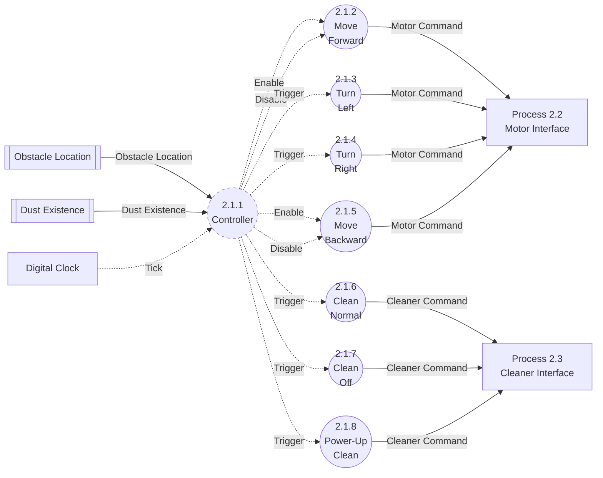

# DFD Level 3: Decomposition of Process 2.1 Main Control

Sources: `preliminary_requirements.md` (R1–R7), `clarifications.md` (C1–C28), `artifacts/SA/event_list.md`, `artifacts/SA/context_diagram.md`, `artifacts/SA/data_dictionary.md` (generated from Rev 5; text re-checked against Rev 8), `artifacts/SA/DFD/dfd_level_0.md`, `artifacts/SA/DFD/dfd_level_1.md`, `artifacts/SA/DFD/dfd_level_2.md`, `artifacts/SA/process_specification.md`.

## Purpose
Level 3 refines **2.1 Main Control** only, following the reference decomposition in the `sa-dfd` skill. It separates control from data processing:

- **2.1.1 Controller** is the only control process. It reads the stored obstacle and dust values, times all durations on Tick, and decides when each action starts or stops. It sends no data. It sends only control signals: Enable, Disable and Trigger.
- **2.1.2–2.1.5** are the movement actions. Each one produces a **Motor Command** for 2.2 Motor Interface.
- **2.1.6–2.1.8** are the cleaning actions. Each one produces a **Cleaner Command** for 2.3 Cleaner Interface.

The decision logic in 2.1 (`process_specification.md`, Process 2.1) is now inside 2.1.1. Level 4 will describe 2.1.1 as an FSM.

## Notation

| Element | Mermaid Representation |
|---|---|
| Data Process | Circular node `(( ))` |
| Control Process | Dashed circular node `(( )):::control` with `classDef control stroke-dasharray: 5 5` |
| Terminator | Rectangle `[ ]` (only the Digital Clock appears here) |
| Sibling process outside the diagram | Rectangle `["Process 2.2 …"]`. **Not a terminator.** |
| Data Store | Subroutine node `[[ ]]` |
| Data Flow | Solid arrow `-->` |
| Control Flow | Dashed arrow `-.->` |
| Enable / Disable | Two dashed arrows from 2.1.1, labeled `Enable` and `Disable` |
| Trigger | One dashed arrow from 2.1.1, labeled `Trigger` |

---

## Diagram: Process 2.1 Main Control

"Process 2.2 Motor Interface" and "Process 2.3 Cleaner Interface" are sibling processes from Level 2, drawn as rectangles to show where the outputs go. **They are not terminators.** The Digital Clock is the only terminator here. The two data stores are the Level 2 stores, written by 1.5 and 1.6.

## Processes

| No. | Name | Type | Function | Inputs | Outputs | Reference |
|---|---|---|---|---|---|---|
| 2.1.1 | Controller | **Control process** | On each Tick, after that tick's sensing (C20), reads Front, Left and Right Obstacle and Dust Existence from the stores. Keeps the current movement, the cleaning mode and the turn, reverse and power-up tick counters. Decides each transition: obstacle avoidance (left first), the 3-tick turn, reversing for at least 3 ticks until a side opens, and the 3-tick power-up. At start-up, enables Move Forward and triggers Clean Normal (C27). Issues Enable, Disable and Trigger only on a state transition (C26). | Obstacle Location (from store), Dust Existence (from store), Tick | Enable / Disable (2.1.2, 2.1.5); Trigger (2.1.3, 2.1.4, 2.1.6, 2.1.7, 2.1.8) | R2–R5, C4–C6, C8–C11, C13–C16, C18, C20, C24–C28 |
| 2.1.2 | Move Forward | Data process (continuous) | While enabled, the movement is Forward. Produces Motor Command = Forward once on Enable. Stays active until disabled. | Enable, Disable | Motor Command (Forward) | R2, R3, C16, C24, C27 |
| 2.1.3 | Turn Left | Data process (one-shot) | Produces Motor Command = Turn Left once per Trigger. The 3-tick duration is timed by 2.1.1, not here. | Trigger | Motor Command (Turn Left) | R3, R4, C4, C5, C25 |
| 2.1.4 | Turn Right | Data process (one-shot) | Produces Motor Command = Turn Right once per Trigger. The 3-tick duration is timed by 2.1.1. | Trigger | Motor Command (Turn Right) | R3, R4, C5, C25 |
| 2.1.5 | Move Backward | Data process (continuous) | While enabled, the movement is Backward. Produces Motor Command = Backward when enabled. Stays active until 2.1.1 disables it: at least 3 ticks, and only once a side opens (C9). | Enable, Disable | Motor Command (Backward) | R4, C9, C24 |
| 2.1.6 | Clean Normal | Data process (one-shot) | Produces Cleaner Command = clean_on once per Trigger. | Trigger | Cleaner Command (clean_on) | R1, R2, R3, C6, C7, C25, C27, C28 |
| 2.1.7 | Clean Off | Data process (one-shot) | Produces Cleaner Command = clean_off once per Trigger. | Trigger | Cleaner Command (clean_off) | R3, C7, C8, C11, C25 |
| 2.1.8 | Power-Up Clean | Data process (one-shot) | Produces Cleaner Command = clean_up once per Trigger. The 3-tick duration is timed by 2.1.1. | Trigger | Cleaner Command (clean_up) | R5, C6, C7, C25 |

## Signal Type Rules (C24, C25, C26)

| Process | Signal from 2.1.1 | Why |
|---|---|---|
| 2.1.2 Move Forward | Enable / Disable | Continuous until stopped |
| 2.1.3 Turn Left | Trigger | One-shot, lasts 3 ticks (C5) |
| 2.1.4 Turn Right | Trigger | One-shot, lasts 3 ticks (C5) |
| 2.1.5 Move Backward | Enable / Disable (C24) | Continuous, at least 3 ticks, until a side opens (C9) |
| 2.1.6 Clean Normal | Trigger (C25) | One-shot: sends clean_on once |
| 2.1.7 Clean Off | Trigger (C25) | One-shot: sends clean_off once |
| 2.1.8 Power-Up Clean | Trigger (C25) | One-shot: sends clean_up once (lasts 3 ticks, C6) |

Checks on the diagram:
- No Trigger goes to 2.1.2 Move Forward or 2.1.5 Move Backward.
- No Enable / Disable goes to 2.1.6 Clean Normal, 2.1.7 Clean Off or 2.1.8 Power-Up Clean.
- Tick goes only to 2.1.1. The action processes have no timing input, so 2.1.1 times every duration: turn 3 ticks (C5), reverse at least 3 ticks (C9), power-up 3 ticks (C6).
- Signals are issued only on a state transition (C26). So Motor Command and Cleaner Command are produced only when the decision changes.

## Controller Interface

This is the full interface of 2.1.1. Level 4 builds the FSM from it.

| Events in | Conditions in | Control signals out |
|---|---|---|
| **Tick** (Digital Clock, C17, C20). This is the only event. Every decision is made on Tick, after that tick's sensing. | **F** = Front Obstacle (from Obstacle Location store) | **Enable** Move Forward (2.1.2) |
| | **L** = Left Obstacle (from Obstacle Location store) | **Disable** Move Forward (2.1.2) |
| | **R** = Right Obstacle (from Obstacle Location store) | **Trigger** Turn Left (2.1.3) |
| | **D** = Dust Existence (from Dust Existence store) | **Trigger** Turn Right (2.1.4) |
| | Internal to 2.1.1, not a store: turn tick count, reverse tick count, power-up tick count (each compared with 3) | **Enable** Move Backward (2.1.5) |
| | | **Disable** Move Backward (2.1.5) |
| | | **Trigger** Clean Normal (2.1.6) |
| | | **Trigger** Clean Off (2.1.7) |
| | | **Trigger** Power-Up Clean (2.1.8) |

A front interrupt is not an event for 2.1.1. It updates the Obstacle Location store straight away, and 2.1.1 reads F at the next Tick (C20).

### Signals per situation (from the 2.1 decision rules)

Every row is a state transition. A tick that matches no row issues no signal (C26).

| # | Situation on Tick | Signals issued by 2.1.1 | Reference |
|---|---|---|---|
| S0 | Start-up | Enable Move Forward; Trigger Clean Normal. These produce the start-up Forward and clean_on (C22); there is no separate start-up send (see Note 2). | C16, C22, C24, C25, C27 |
| S1 | Moving forward, F = true, L = false | Disable Move Forward; Trigger Clean Off; Trigger Turn Left. A power-up in progress is cancelled. | R3, C4, C8, C11, C18 |
| S2 | Moving forward, F = true, L = true, R = false | Disable Move Forward; Trigger Clean Off; Trigger Turn Right. A power-up in progress is cancelled. | R3, C4, C8, C11, C18 |
| S3 | Moving forward, F = true, L = true, R = true | Disable Move Forward; Trigger Clean Off; Enable Move Backward. A power-up in progress is cancelled. | R4, C8, C9, C11 |
| S4 | Moving forward with clean_on, F = false, D = true | Trigger Power-Up Clean. This also applies on a tick after a power-up has ended, which is a new power-up, not a restart (C28). | R5, C6, C28 |
| S5 | Moving forward with clean_up, F = false, 3 power-up ticks elapsed | Trigger Clean Normal. D is not tested on this tick (C28). | C6, C14, C28 |
| S6 | Turning, 3 turn ticks elapsed, F = false | Enable Move Forward; Trigger Clean Normal | R3, C5 |
| S7 | Turning, 3 turn ticks elapsed, F = true | New avoidance decision: Trigger Turn Left (L = false), or Trigger Turn Right (L = true, R = false), or Enable Move Backward (L = R = true). The mode stays clean_off. | C4, C9, C15, C18 |
| S8 | Reversing, at least 3 reverse ticks, L = false | Disable Move Backward; Trigger Turn Left | R4, C4, C9 |
| S9 | Reversing, at least 3 reverse ticks, L = true, R = false | Disable Move Backward; Trigger Turn Right | R4, C9 |

These ticks issue no signal:
- L or R alone with F = false while moving forward (C13)
- D while turning or reversing (C10)
- D during an active power-up (C14)
- F while turning or reversing, before the period ends (C15)
- F = false (C19)
- a tick that only advances a counter

## Flows

| Flow | Type | Source | Destination | Composition / Values | Reference |
|---|---|---|---|---|---|
| Obstacle Location | Data (store read) | Obstacle Location store | 2.1.1 | Front Obstacle + Left Obstacle + Right Obstacle | R3, R4, C4, C9, C18, C20 |
| Dust Existence | Data (store read) | Dust Existence store | 2.1.1 | Boolean | R5, C10, C14 |
| Tick | Control (temporal) | Digital Clock | 2.1.1 only | occurrence only | C5, C6, C9, C17, C20 |
| Enable (Move Forward) | Control (Enable) | 2.1.1 | 2.1.2 | event, no value | R2, C16, C24, C26, C27 |
| Disable (Move Forward) | Control (Disable) | 2.1.1 | 2.1.2 | event, no value | R3, R4, C24, C26 |
| Trigger (Turn Left) | Control (Trigger) | 2.1.1 | 2.1.3 | event, no value | R3, R4, C4, C5, C25, C26 |
| Trigger (Turn Right) | Control (Trigger) | 2.1.1 | 2.1.4 | event, no value | R3, R4, C5, C25, C26 |
| Enable (Move Backward) | Control (Enable) | 2.1.1 | 2.1.5 | event, no value | R4, C9, C24, C26 |
| Disable (Move Backward) | Control (Disable) | 2.1.1 | 2.1.5 | event, no value | R4, C9, C24, C26 |
| Trigger (Clean Normal) | Control (Trigger) | 2.1.1 | 2.1.6 | event, no value | R1, R2, C7, C25, C26, C27, C28 |
| Trigger (Clean Off) | Control (Trigger) | 2.1.1 | 2.1.7 | event, no value | R3, C7, C8, C25, C26 |
| Trigger (Power-Up Clean) | Control (Trigger) | 2.1.1 | 2.1.8 | event, no value | R5, C6, C7, C25, C26 |
| Motor Command | Data | 2.1.2, 2.1.3, 2.1.4, 2.1.5 | 2.2 Motor Interface | Forward (2.1.2) / Turn Left (2.1.3) / Turn Right (2.1.4) / Backward (2.1.5) | R2–R4, C4, C5, C9, C24, C25 |
| Cleaner Command | Data | 2.1.6, 2.1.7, 2.1.8 | 2.3 Cleaner Interface | clean_on (2.1.6) / clean_off (2.1.7) / clean_up (2.1.8) | R1, R3, R5, C6–C8, C11, C25 |

All 9 control signals match the entries in `data_dictionary.md` Section 2.1 (provisional in Rev 5, numbered since Rev 6). Their destinations now have process numbers. No signal was added beyond C24 and C25.

## Data Stores
No new data stores. 2.1.1 reads the two Level 2 stores, **Obstacle Location** and **Dust Existence**. The current movement, cleaning mode and the three tick counters are used only by 2.1.1. They stay hidden inside it and are not data stores (information hiding). Level 4 shows them as FSM states and timing conditions.

## Processes Not Decomposed

| Process | Reason |
|---|---|
| 1.1 Front Sensor Interface | Primitive. It passes on one Boolean when an interrupt arrives. It has no internal decisions to separate. |
| 1.2 Left Sensor Interface | Primitive. One sample per Tick, passed on unchanged. |
| 1.3 Right Sensor Interface | Primitive. One sample per Tick, passed on unchanged. |
| 1.4 Dust Sensor Interface | Primitive. One sample per Tick, passed on unchanged. |
| 1.5 Determine Obstacle Location | Primitive. It updates one component of a store and needs no control logic. |
| 1.6 Determine Dust Existence | Primitive. It writes one Boolean to a store. |
| 2.2 Motor Interface | Primitive. It does one compare-and-send (C12). It has no separate start-up send: the start-up Direction (C22) is the first Motor Command, from the S0 Enable of Move Forward (C27). Its process specification fully covers it. |
| 2.3 Cleaner Interface | Primitive. It does one compare-and-send (C12). It has no separate start-up send: the start-up Clean (C22) is the first Cleaner Command, from the S0 Trigger of Clean Normal (C27). Its process specification fully covers it. |

These processes stay as Level 2 primitives and are covered by their Level 2 process specifications. The reference decomposition decomposes only 2.1.

---

## Balancing with DFD Level 2 (Process 2.1)

| Level 2 Flow (Process 2.1) | Direction | Style | Level 3 Flow | Style | Level 3 Endpoint | Balanced |
|---|---|---|---|---|---|---|
| Obstacle Location | In (from store) | Solid (data) | Obstacle Location | Solid (data) | Obstacle Location store → 2.1.1 | Yes |
| Dust Existence | In (from store) | Solid (data) | Dust Existence | Solid (data) | Dust Existence store → 2.1.1 | Yes |
| Tick | In | Dashed (control) | Tick | Dashed (control) | Digital Clock → 2.1.1 | Yes |
| Motor Command | Out | Solid (data) | Motor Command | Solid (data) | 2.1.2, 2.1.3, 2.1.4, 2.1.5 → 2.2 (one flow with four producers) | Yes |
| Cleaner Command | Out | Solid (data) | Cleaner Command | Solid (data) | 2.1.6, 2.1.7, 2.1.8 → 2.3 (one flow with three producers) | Yes |

### Summary
- **Inputs:** 3 at Level 2 and 3 at Level 3, with the same names, sources and styles. All three go to 2.1.1.
- **Outputs:** 2 at Level 2 and 2 at Level 3, with the same names, destinations and styles. Each output now has several producers. Each producer makes exactly one value of the flow's value set, as listed in Data Dictionary Section 4.4. The value sets are unchanged: 4 Motor Command values and 3 Cleaner Command values.
- **New internal flows:** the 9 control signals (Enable, Disable and Trigger) from 2.1.1. They stay inside 2.1.
- **Data stores:** none added. Both stores are read as at Level 2.
- **Rest of Level 2:** 1.1–1.6, 2.2 and 2.3 are unchanged. The Level 1 and Level 2 balancing still holds.
- **External entities:** only the Digital Clock appears here, through Tick, which was already an input of 2.1. None added.
- **Unexplained external flows:** none.
- **Result:** Level 3 is balanced with Process 2.1 at Level 2.

## Traceability to the Process 2.1 Specification

| 2.1 logic (`process_specification.md`) | Level 3 process |
|---|---|
| On Tick, read Obstacle Location and Dust Existence (C18, C20) | 2.1.1 |
| Forward cleaning (R2, C13) | 2.1.1 → Enable 2.1.2; 2.1.6 |
| Front obstacle: cancel power-up, clean_off, turn left, turn right or reverse (R3, R4, C4, C8, C11, C18) | 2.1.1 → Disable 2.1.2; Trigger 2.1.7; Trigger 2.1.3 / 2.1.4 or Enable 2.1.5 |
| 3-tick turn, then forward or a new decision (C5, C15) | 2.1.1 (timing); 2.1.3, 2.1.4; then 2.1.2 + 2.1.6, or a new avoidance decision |
| Reverse for at least 3 ticks, then turn when a side opens (C9) | 2.1.1 (timing); 2.1.5; Disable 2.1.5 and then 2.1.3 / 2.1.4 |
| 3-tick dust power-up, no restart, ignored while turning or reversing (R5, C6, C10, C14) | 2.1.1 (timing and conditions); 2.1.8, then 2.1.6 |
| `SetMove(m)`: output Motor Command only on a transition | 2.1.2–2.1.5, activated by 2.1.1 (C24–C26) |
| `SetMode(c)`: output Cleaner Command only on a transition | 2.1.6–2.1.8, activated by 2.1.1 (C25, C26) |

## Notes and Issues

1. **When a continuous process produces its command (Data Dictionary Open Issue 10). Resolved (C24).** C24 states it directly: "On Enable, the process produces its Motor Command once; while enabled it produces nothing further; on Disable it stops." This matches the structure here, where Tick goes only to 2.1.1 and 2.1.2 and 2.1.5 have no tick input. *(Earlier text read this from the structure and asked for confirmation.)*
2. **Start-up Enable of Move Forward. Resolved (C27).** At start-up, 2.1.1 enables Move Forward **and** triggers Clean Normal (S0; Level 4 FSM initial transition T1). These produce Motor Command = Forward and Cleaner Command = clean_on, which are the start-up Direction and Clean of C22. 2.2 and 2.3 have sent nothing yet, so neither command is filtered, and there is no separate start-up send. This keeps the initial Enable of the earlier option (a), adds the Clean Normal Trigger, and rules out option (b) (Move Forward active from initialisation with no Enable). `process_specification.md` 2.1 step 4 was revised to match (PS Rev 6). *(Earlier text marked this "Needs a decision" and had no cleaner Trigger at start-up.)*
3. **A repeated turn at the end of a turn (C15).** In S7, a new decision can Trigger the same turn process again. That is a new Trigger, so it produces a new Motor Command with the same value, and 2.2 then filters it (C12). This matches 2.1 step 3.
4. **Order of signals within one transition.** S1–S3 and S6–S9 issue two or three signals on the same tick, for example Disable Move Forward, Trigger Clean Off and Trigger Turn Left. The requirements do not state an order, and the outputs do not depend on one: the motor and cleaner signals go to different interfaces, and Disable produces no command. This is left to the Level 4 FSM actions and to SD.
5. **Tick counters stay inside 2.1.1.** The turn, reverse and power-up counters are timing state of the Controller. They are not passed to the one-shot processes and are not stores (C5, C6, C9, Signal Type Rules).
6. **Follow-up artifacts. Done** (DD Rev 6–8, PS Rev 5–7, `dfd_level_4_fsm.md`). Original note:
   - Data Dictionary: give the 9 control signals their process numbers (2.1.1 → 2.1.2–2.1.8) and set their DFD Level to 3. Set the Level 3 producers in Section 4.4. Mark Open Issue 10 as resolved per Note 1. Use `/sa-data-dictionary`.
   - Process Specifications: add specifications for 2.1.1–2.1.8. Revise 2.1 step 4 per Note 2. Use `/sa-process-specification`.
   - Then generate the Level 4 Controller FSM with `/sa-dfd 4`.
