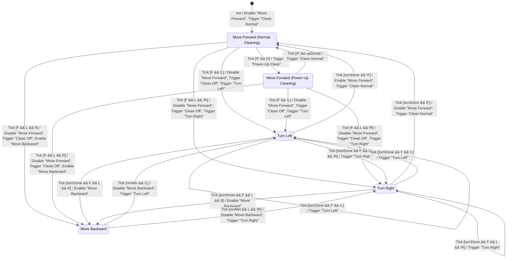

# DFD Level 4: Controller FSM (Process 2.1.1 Controller)

Sources: `preliminary_requirements.md` (R1–R7), `clarifications.md` (C1–C29), `artifacts/SA/DFD/dfd_level_3.md` (Controller Interface, Signal Type Rules, Signals per situation S0–S9), `artifacts/SA/data_dictionary.md` (Sections 2.1, 4.5, 4.6), `artifacts/SA/process_specification.md` (Processes 2.1 and 2.1.1).

## Purpose
Level 4 describes **2.1.1 Controller**, the only control process at Level 3, as a finite state machine. The FSM uses only the Controller's Level 3 interface:

- **Event in:** Tick (the only event, C17, C20). Decisions are made on Tick, after that tick's sensing.
- **Conditions in:** F, L, R (Obstacle Location store), D (Dust Existence store), and the internal tick counters (Data Dictionary Section 4.6).
- **Actions out:** only Enable / Disable (2.1.2 Move Forward, 2.1.5 Move Backward) and Trigger (2.1.3, 2.1.4, 2.1.6, 2.1.7, 2.1.8).

No Process Specification is written for this level (project rule).

## Notation

| Symbol | Meaning |
|---|---|
| `F`, `L`, `R` | Front, Left, Right Obstacle (true = blocked), read from the Obstacle Location store |
| `D` | Dust Existence (true = dust), read from the Dust Existence store |
| `turnDone` | turn tick count = 3 (C5) |
| `upDone` | power-up tick count = 3 (C6) |
| `revMin` | reverse tick count ≥ 3 (C9) |
| `!`, `&&` | NOT, AND |
| Label | `Event [Condition] / Action, Action, …` (actions listed in the order issued) |

**Tick counters (internal to 2.1.1, not outputs).** Each timed state has its own counter from Data Dictionary Section 4.6. The counter is set to 0 when the state is entered (including re-entry by a self-transition). On each later Tick handled in that state, it is incremented by 1 before the guards are evaluated. So a state entered on tick *k* reaches count 3 on tick *k*+3, and the activity lasts ticks *k* to *k*+2, which is 3 ticks. This matches the 2.1 pseudocode. Counter updates are not FSM actions. Width and saturation are SD detail.

## FSM Diagram

Ticks on which the FSM stays in the same state issue no signal (C26). To keep the diagram readable, they are not drawn. They are listed as "stay" rows (T5, T10, T12, T17, T24, T25) in the Transition Table. The two drawn self-transitions (T13, T18) are different: they re-enter the state, reset the turn counter and issue a new Trigger (C15).

## Transition Table

Rows for one state are listed in priority order. Within a state the guards do not overlap, so the order only shows the rule "front before dust, left before right".

| # | Current State | Event | Condition | Actions (in order) | Next State | Source |
|---|---|---|---|---|---|---|
| T1 | [*] | Init | - | Enable "Move Forward"; Trigger "Clean Normal" | FwdNormal | C16, C22, C24, C25, C27 |
| T2 | FwdNormal | Tick | F && !L | Disable "Move Forward"; Trigger "Clean Off"; Trigger "Turn Left" | TurnLeft | R3, C4, C8, C18, C20 |
| T3 | FwdNormal | Tick | F && L && !R | Disable "Move Forward"; Trigger "Clean Off"; Trigger "Turn Right" | TurnRight | R3, C4, C8, C18, C20 |
| T4 | FwdNormal | Tick | F && L && R | Disable "Move Forward"; Trigger "Clean Off"; Enable "Move Backward" | MoveBackward | R4, C8, C9, C20 |
| T5 | FwdNormal | Tick | !F && !D | none (stay). L or R alone causes no reaction | FwdNormal | R2, C13, C19, C26 |
| T6 | FwdNormal | Tick | !F && D | Trigger "Power-Up Clean" | FwdPowerUp | R5, C6, C7, C28 (front before dust) |
| T7 | FwdPowerUp | Tick | F && !L | Disable "Move Forward"; Trigger "Clean Off"; Trigger "Turn Left" | TurnLeft | R3, C4, C8, C11, C18 |
| T8 | FwdPowerUp | Tick | F && L && !R | Disable "Move Forward"; Trigger "Clean Off"; Trigger "Turn Right" | TurnRight | R3, C4, C8, C11, C18 |
| T9 | FwdPowerUp | Tick | F && L && R | Disable "Move Forward"; Trigger "Clean Off"; Enable "Move Backward" | MoveBackward | R4, C8, C9, C11 |
| T10 | FwdPowerUp | Tick | !F && !upDone | none (stay). D is ignored (no restart); L or R alone causes no reaction | FwdPowerUp | C6, C13, C14, C26 |
| T11 | FwdPowerUp | Tick | !F && upDone | Trigger "Clean Normal" | FwdNormal | C6, C14, C28 |
| T12 | TurnLeft | Tick | !turnDone | none (stay). F and D are ignored | TurnLeft | C5, C10, C15, C26 |
| T13 | TurnLeft | Tick | turnDone && F && !L | Trigger "Turn Left" (re-entry, turn counter reset) | TurnLeft | C4, C5, C15, C18 |
| T14 | TurnLeft | Tick | turnDone && F && L && !R | Trigger "Turn Right" | TurnRight | C4, C5, C15, C18 |
| T15 | TurnLeft | Tick | turnDone && F && L && R | Enable "Move Backward" | MoveBackward | R4, C5, C9, C15 |
| T16 | TurnLeft | Tick | turnDone && !F | Enable "Move Forward"; Trigger "Clean Normal". D is not tested on this tick | FwdNormal | R3, C5, C7, C29 |
| T17 | TurnRight | Tick | !turnDone | none (stay). F and D are ignored | TurnRight | C5, C10, C15, C26 |
| T18 | TurnRight | Tick | turnDone && F && L && !R | Trigger "Turn Right" (re-entry, turn counter reset) | TurnRight | C4, C5, C15, C18 |
| T19 | TurnRight | Tick | turnDone && F && !L | Trigger "Turn Left" | TurnLeft | C4, C5, C15, C18 |
| T20 | TurnRight | Tick | turnDone && F && L && R | Enable "Move Backward" | MoveBackward | R4, C5, C9, C15 |
| T21 | TurnRight | Tick | turnDone && !F | Enable "Move Forward"; Trigger "Clean Normal". D is not tested on this tick | FwdNormal | R3, C5, C7, C29 |
| T22 | MoveBackward | Tick | revMin && !L | Disable "Move Backward"; Trigger "Turn Left". D is not tested on this tick | TurnLeft | R4, C4, C9, C29 |
| T23 | MoveBackward | Tick | revMin && L && !R | Disable "Move Backward"; Trigger "Turn Right". D is not tested on this tick | TurnRight | R4, C4, C9, C29 |
| T24 | MoveBackward | Tick | !revMin | none (stay). F, L, R and D are ignored | MoveBackward | C9, C10, C15, C26 |
| T25 | MoveBackward | Tick | revMin && L && R | none (stay). Both sides still blocked | MoveBackward | C9, C26 |

### Mapping to Level 3 situations (S0–S9)

| Level 3 situation | FSM transitions |
|---|---|
| S0 Start-up | T1 (follows C27; see Issue 1) |
| S1 Front blocked, left free | T2, T7 |
| S2 Front and left blocked, right free | T3, T8 |
| S3 Front, left and right blocked | T4, T9 |
| S4 Dust while forward with clean_on | T6 |
| S5 Power-up ends | T11 |
| S6 Turn ends, front clear | T16, T21 |
| S7 Turn ends, front still blocked | T13, T14, T15, T18, T19, T20 |
| S8 Reverse ends, left free | T22 |
| S9 Reverse ends, left blocked, right free | T23 |
| "These ticks issue no signal" | T5, T10, T12, T17, T24, T25 |

## State Table

| State | Meaning | Active motor process | Last motor command | Cleaner mode | Timer used | Entered by |
|---|---|---|---|---|---|---|
| FwdNormal (initial) | Move forward with normal cleaning | 2.1.2 Move Forward (enabled) | Forward | clean_on | none | T1, T11, T16, T21 |
| FwdPowerUp | Move forward with powered-up cleaning | 2.1.2 Move Forward (enabled, unchanged from FwdNormal) | Forward | clean_up | power-up tick count, `upDone` = 3 (C6) | T6 |
| TurnLeft | Turn aside left | none (2.1.3 is one-shot) | Turn Left | clean_off | turn tick count, `turnDone` = 3 (C5) | T2, T7, T13, T19, T22 |
| TurnRight | Turn aside right | none (2.1.4 is one-shot) | Turn Right | clean_off | turn tick count, `turnDone` = 3 (C5) | T3, T8, T14, T18, T23 |
| MoveBackward | Move backward | 2.1.5 Move Backward (enabled) | Backward | clean_off | reverse tick count, `revMin` ≥ 3 (C9) | T4, T9, T15, T20 |

Exactly the five required states are used. There is no Stop or Idle state.

## Validation

### Clarification coverage

| Rule | Where in the FSM | Result |
|---|---|---|
| C4 left before right | Every avoidance choice tests `!L` before `L && !R`: T2/T3, T7/T8, T13/T14, T19/T18, T22/T23 | Covered |
| Front before dust | FwdNormal: F rows (T2–T4) exclude D; T6 requires `!F` | Covered |
| C5 turn lasts 3 ticks | `turnDone` guards T13–T16, T18–T21; T12, T17 stay | Covered |
| C6 power-up lasts 3 ticks | `upDone` guard T11; T10 stays | Covered |
| C8 clean_off only while turning or reversing | Clean Off is triggered only on entry to TurnLeft, TurnRight, MoveBackward from a forward state (T2–T4, T7–T9). Every exit to a forward state triggers Clean Normal (T16, T21). Turn↔turn and turn↔reverse keep clean_off with no cleaner Trigger | Covered |
| C9 reverse ≥ 3 ticks, until a side opens, then turn left first | T24 (`!revMin`), T25 (both blocked), T22, T23 | Covered |
| C10 dust ignored while turning or reversing | No guard in TurnLeft, TurnRight, MoveBackward uses D | Covered |
| C11 obstacle cancels power-up | T7–T9 leave FwdPowerUp with Clean Off; the power-up counter is reset on the next entry to FwdPowerUp | Covered |
| C13 side-only obstacle causes no transition | T5, T10 (`!F`, any L/R) | Covered |
| C14 no power-up restart | T10: D is not tested in FwdPowerUp | Covered |
| C15 front not acted on during turn/reverse; front still blocked when a turn ends → new decision | T12, T17, T24 ignore F; T13–T15, T18–T20 | Covered |
| C24 / C25 signal types | Enable/Disable only for Move Forward and Move Backward; Trigger only for Turn Left, Turn Right, Clean Normal, Clean Off, Power-Up Clean | Covered |
| C26 signals only on a transition | All actions are on transitions; stay rows have no actions | Covered |
| C27 initial transition | T1: Enable "Move Forward"; Trigger "Clean Normal" | Covered |
| C28 power-up ends with clean_on; later dust starts a new power-up | T11 returns to FwdNormal on the tick `upDone` holds, without testing D; T6 starts a new power-up on a later tick if D | Covered |
| C29 dust ignored on the tick a turn or reverse ends | T16, T21 (turn ends, front clear) go to FwdNormal without testing D; T6 acts on D from the next tick. T13–T15, T18–T20, T22 and T23 lead to a turn or reverse state, where D is still ignored (C10) | Covered |

### Enable / Disable ordering (skill rule 13)

| Enable | Previously enabled motor process | Disabled first? |
|---|---|---|
| Enable "Move Backward" in T4, T9 | Move Forward | Yes, Disable "Move Forward" is the first action |
| Enable "Move Backward" in T15, T20 | none (Move Forward was disabled on entry to the turn; turns are one-shot) | Not needed |
| Enable "Move Forward" in T16, T21 | none (the turn was entered from a forward state with Disable, or from MoveBackward with Disable "Move Backward") | Not needed |
| Enable "Move Forward" in T1 | none (start-up) | Not needed |

At most one continuous motor process is enabled at any time. Move Backward is never left enabled when the FSM leaves MoveBackward (T22, T23 disable it first).

### Guard completeness and disjointness (on Tick)

| State | Guards | Complete? | Disjoint? |
|---|---|---|---|
| FwdNormal | F&&!L, F&&L&&!R, F&&L&&R, !F&&!D, !F&&D | Yes: all 16 combinations of F, L, R, D | Yes |
| FwdPowerUp | F&&!L, F&&L&&!R, F&&L&&R, !F&&!upDone, !F&&upDone | Yes | Yes |
| TurnLeft / TurnRight | !turnDone; turnDone && (!F, F&&!L, F&&L&&!R, F&&L&&R) | Yes | Yes |
| MoveBackward | !revMin; revMin && (!L, L&&!R, L&&R) | Yes | Yes |

### Structural checks

| Check | Result |
|---|---|
| All states defined | Yes, 5 states, as listed in the skill |
| Initial state | FwdNormal, by T1 |
| Every transition has a valid source and target | Yes |
| Unreachable states | None. FwdNormal (T1), FwdPowerUp (T6), TurnLeft (T2), TurnRight (T3), MoveBackward (T4) |
| States with no outgoing transition | None. Every state has at least one exit on Tick |
| Possible endless stay | MoveBackward stays while L && R (T25), and the turn states can repeat while F stays true (T13, T18). Both are what C9 and C15 state |
| Events come from Level 3 | Yes. Tick only; Init is the start-up pseudo-event |
| Actions match Level 3 Controller outputs | Yes. All 9 control signals in the Level 3 Controller Interface are used, and no others |
| Conditions match Level 3 | Yes. F, L, R, D and the three counters from DD Section 4.6 |
| No Trigger to Move Forward / Move Backward; no Enable/Disable to a Clean process | Yes |

### Consistency with Level 3 (balancing)

| Level 3 interface of 2.1.1 | Level 4 FSM | Balanced |
|---|---|---|
| In: Tick | Event Tick | Yes |
| In: Obstacle Location (F, L, R) | Guards on F, L, R | Yes |
| In: Dust Existence (D) | Guards on D (forward states only) | Yes |
| Out: Enable / Disable Move Forward | T1, T16, T21 / T2–T4, T7–T9 | Yes |
| Out: Enable / Disable Move Backward | T4, T9, T15, T20 / T22, T23 | Yes |
| Out: Trigger Turn Left, Turn Right | T2, T7, T13, T19, T22 / T3, T8, T14, T18, T23 | Yes |
| Out: Trigger Clean Normal, Clean Off, Power-Up Clean | T1, T11, T16, T21 / T2–T4, T7–T9 / T6 | Yes |

## Issues

1. **C27 differs from Level 3 S0. Resolved.** The follow-ups below were done: `data_dictionary.md` Rev 7, `process_specification.md` Rev 6, and `dfd_level_3.md` (S0 and Notes 1–2) in the SA consistency pass. Level 3 S0 now lists Enable Move Forward and Trigger Clean Normal, matching T1. Original issue: C27 (new) says that at start-up the Controller enables Move Forward **and triggers Clean Normal**, and that these produce the start-up commands of C22, with no separate start-up send. The FSM follows C27 (T1). The following still say otherwise and should be updated:
   - `dfd_level_3.md` S0: "No cleaner Trigger: the mode is already clean_on", and Note 2 (C27 settles it as option (a), plus the Clean Normal Trigger).
   - `process_specification.md`: 2.1 step 4 and INIT ("no Cleaner Command"), 2.1.1 S0, and Open Issue 14 (now resolved by C27). Processes 2.2 and 2.3 say "sends ... once at start-up". Under C27 the start-up Direction and Clean come from the Move Forward and Clean Normal commands, so 2.2/2.3 would send them as their first value under C12 rather than as a separate send.
   - `data_dictionary.md`: Open Issue 12 (resolved by C27); Trigger "Clean Normal" should list start-up (T1) as a use.
   Direction and Clean at start-up are the same either way (Forward, clean_on).
2. **Dust on the tick a power-up ends. Resolved (C28).** On T11 the FSM returns to FwdNormal without testing D, as in the 2.1 pseudocode. If D is still true on the next tick, T6 starts a new power-up. C28 confirms this reading: the RVC returns to normal cleaning on the tick the power-up ends, and dust on a later tick starts a new power-up, which is not a restart under C14. No transition changed.
3. **Turn re-entry (T13, T18).** When a turn ends with the front still blocked and the same side free, the FSM re-enters the same turn state and triggers the same turn process again. The new Motor Command has the same value, and 2.2 filters it (C12). This matches `dfd_level_3.md` Note 3.
4. **Signal order within a transition.** The requirements give no order (`dfd_level_3.md` Note 4). The FSM fixes one: Disable first (rule 13), then the cleaner Trigger, then the movement Trigger or Enable. Exits to a forward state use Enable "Move Forward" and then Trigger "Clean Normal". No output depends on this order.
5. **Counters.** The FSM uses the three counters from DD Section 4.6 with reset on entry and increment per Tick. Their representation is left to SD.
6. **Dust on the tick a turn or reverse ends. Resolved (C29).** No guard on an exit from TurnLeft, TurnRight or MoveBackward tests D, so dust on that tick is ignored. After a turn ends with the front clear (T16, T21), the FSM is in FwdNormal, and T6 starts a power-up on the next tick if D is still true. After a reverse ends (T22, T23), the next state is a turn, so D stays ignored under C10 until that turn ends. No transition changed; only citations were added.
