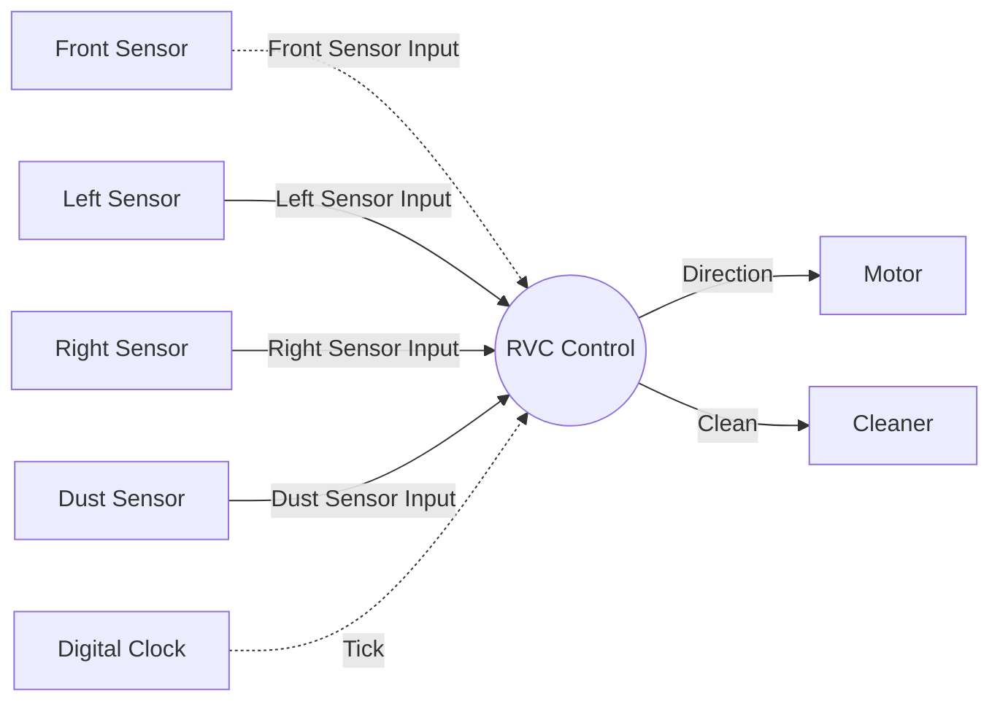

# System Context Diagram

Sources: `preliminary_requirements.md` (R1–R7), `clarifications.md` (C1–C28), `artifacts/SA/event_list.md` (Rev 3).

## Revision History

| Rev | Trigger | Changes |
|---|---|---|
| 1 | Initial generation | Context Diagram from the Event List (C1–C8). |
| 2 | Consistency update after DFD Level 2 (approved) | Renamed the system process from "RVC Controller" to "RVC Control" to match DFD Level 0. Added citations to C9–C20. Updated the Open Issues to match the Event List Rev 2. The boundary, entities and flows are unchanged. |
| 3 | SA consistency pass (C1–C28) | Added citations to C21–C28 (Motor, Cleaner and Digital Clock rows). Updated the Open Issues to match the Event List Rev 3. The diagram, boundary, entities and flows are unchanged. |

## Notation
- Process: Circle representing the entire system (RVC Control).
- Terminator: Rectangle representing an external entity.
- Data flow: Solid arrow (`-->`) representing a flow-oriented input or an output command.
- Control flow: Dashed arrow (`-.->`) representing a control or temporal event (interrupt-driven Front Sensor Input, and Tick).
- Flow Label: Exact event name from the Event List.

## Diagram

## System Boundary
- **Inside:** RVC Control, the automatic cleaning control logic (R7). It decides the movement direction and cleaning mode from the sensor inputs and the clock.
- **Outside:** Sensors, the digital clock and the actuators. They are treated as abstract external entities because hardware control details are out of scope (R6, C17).
- **Excluded:** No user, charging or battery entities. Only the automatic cleaning function is modelled (R7).

## External Entities

| Entity | Role | Flows | Reference |
|---|---|---|---|
| Front Sensor | Detects an obstacle in front; interrupt-driven, Boolean | Front Sensor Input (in, control) | R3, R4, C1, C3, C19, C20 |
| Left Sensor | Detects an obstacle on the left; periodic (once per tick), Boolean | Left Sensor Input (in, data) | R3, R4, C2, C3, C17 |
| Right Sensor | Detects an obstacle on the right; periodic (once per tick), Boolean | Right Sensor Input (in, data) | R3, R4, C2, C3, C17 |
| Dust Sensor | Detects dust on the floor; periodic (once per tick), Boolean | Dust Sensor Input (in, data) | R5, C2, C3, C17 |
| Digital Clock | Provides the abstract time base for sampling, control decisions and the 3-tick durations | Tick (in, temporal) | C2, C5, C6, C9, C17, C20, C28 |
| Motor | Executes movement commands: Forward / Backward / Turn Left / Turn Right; sent once at start-up, then only on change | Direction (out) | R2, R3, R4, C4, C5, C9, C12, C16, C22, C27 |
| Cleaner | Executes cleaning and mopping commands: clean_off / clean_on / clean_up; sent once at start-up, then only on change | Clean (out) | R1, R3, R5, C7, C8, C11, C12, C16, C22, C27, C28 |

## Consistency Check with Event List

| Event List Entry | Category (Event List) | Arrow in Diagram | Style | Present |
|---|---|---|---|---|
| Front Sensor Input | Control event (interrupt) | Front Sensor → RVC Control | Dashed | Yes |
| Left Sensor Input | Flow-oriented, periodic | Left Sensor → RVC Control | Solid | Yes |
| Right Sensor Input | Flow-oriented, periodic | Right Sensor → RVC Control | Solid | Yes |
| Dust Sensor Input | Flow-oriented, periodic | Dust Sensor → RVC Control | Solid | Yes |
| Tick | Temporal event | Digital Clock → RVC Control | Dashed | Yes |
| Direction | Output command | RVC Control → Motor | Solid | Yes |
| Clean | Output command | RVC Control → Cleaner | Solid | Yes |

- All 7 Event List entries appear exactly once, with the same label and direction.
- There are no arrows without a matching Event List entry, and no unlabelled arrows.
- There is exactly one system process and no internal components.
- The system process name "RVC Control" matches DFD Level 0 (Process 0).

## Open Issues
None. Event List Open Issues 1–7 are resolved (C9, C10, C13, C14, C17, C18, and the file-name correction; see `artifacts/SA/event_list.md`). Re-checked against C1–C28: C21–C28 refine start-up, internal Level 3 control and the end of a power-up. None of these changed the system boundary or the external flows.
