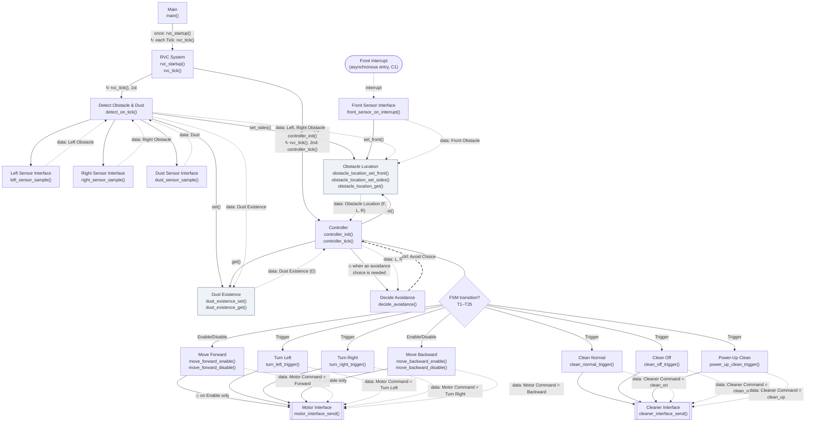
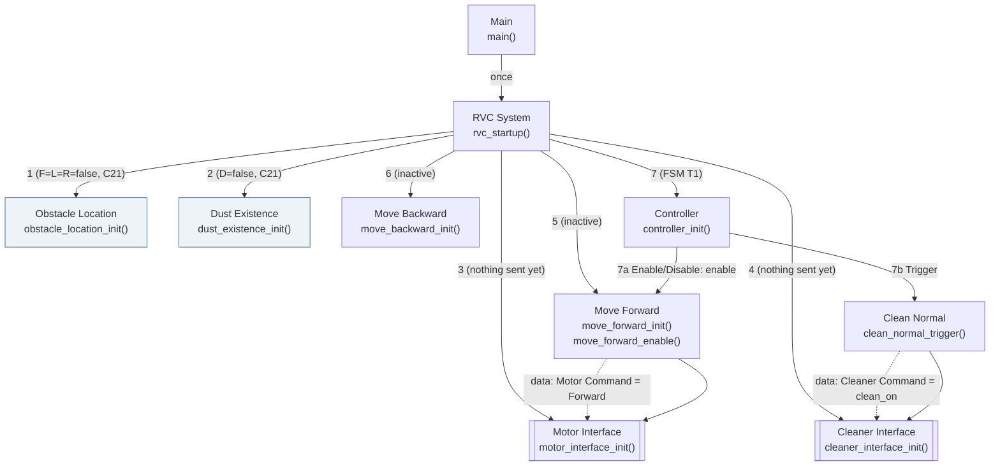

# Structure Chart

Sources: `artifacts/SD/transform_analysis.md`, `preliminary_requirements.md` (R1–R7), `clarifications.md` (C1–C29), `artifacts/SA/DFD/dfd_level_0.md` – `dfd_level_3.md`, `artifacts/SA/DFD/dfd_level_4_fsm.md` (T1–T25), `artifacts/SA/data_dictionary.md` (Rev 8), `artifacts/SA/process_specification.md` (Rev 8).

## 1. Objective
This document defines the hierarchical C module structure for the RVC. It is derived from the Transform Analysis and the approved SA artifacts. Each module is a C translation unit (`.c` / `.h`) with the functions listed in Section 5. An arrow is a real C function call. No implementation code is given here.

### Approval Record

| Item | Value |
|---|---|
| Status | **Approved** by the project owner, 2026-11-08 |
| Change requested at approval (applied) | The start-up sequence (former Section 3.2, steps 1–7) moves into `rvc_startup()`. The per-Tick body moves into `rvc_tick()` = `detect_on_tick()` + `controller_tick()`. `main()` calls these two. Both are in the new module **RVC System** (`rvc.c`) |
| Decisions confirmed | Section 9, items 1–6 |
| Next phase | TDD. It is on hold until the project owner updates the TDD skills |

## 2. Notation

| Element | Mermaid Representation | Used for |
|---|---|---|
| Module | Rectangle `[ ]` | Every module |
| Library Module | Subroutine `[[ ]]` | 2.2 Motor Interface and 2.3 Cleaner Interface. They are shared, and they apply C12 |
| Data-store module | Rectangle, class `store` (shaded) | Obstacle Location, Dust Existence. Each one hides its store behind access functions |
| Asynchronous entry | Stadium `([ ])` | Front interrupt (C1). It is not a module and it is not called by Main |
| Module Call | Solid arrow `-->` | One C function call, caller → callee |
| Data Information (data couple) | Dotted arrow `-.->`, label starting `data:` | Parameter or return value carrying DD data |
| Control Information (control couple) | Dashed arrow (dotted arrow with `linkStyle` dash 10 5), label starting `ctrl:` | Value that steers what the receiver does |
| Control couple carried by the call | Call arrow labelled `Enable/Disable` or `Trigger` | Controller → action modules. Each signal is its own parameterless function, so the call *is* the signal (C24, C25) |
| Decision | Diamond `{ }` attached to the caller with `---` | The calls below it are conditional |
| Iteration | Label `↻` on the call arrow | Repeated call |
| Conditional call (single) | Label `◇` on the call arrow | Call made only when its condition holds |

Mermaid only approximates classic Structure Chart notation. The labels are what distinguish calls, data couples and control couples.

## 3. Module Hierarchy

### 3.1 Structure Chart

How to read the chart:
- **Top**: Main → RVC System. Main only waits for the Tick and calls `rvc_startup()` once, then `rvc_tick()` on each Tick. RVC System holds the start-up order and the per-Tick order. The start-up calls are shown in Section 3.2.
- **Afferent branch** (left): RVC System → Detect Obstacle & Dust → Left / Right / Dust Sensor Interface, then → Obstacle Location / Dust Existence. Front Sensor Interface writes Obstacle Location from the interrupt.
- **Central transform**: RVC System → Controller. The Controller reads the two store modules and uses Decide Avoidance.
- **Efferent branch** (below the diamond): Controller → the 7 action modules → Motor Interface / Cleaner Interface. The Motor and Cleaner terminators sit behind the library modules. They are not modules (Section 5.5).

The efferent branch hangs under the Controller, not under Main or RVC System. The Central→Efferent boundary flows are control signals issued only on a transition (C26), so only the Controller knows when to call them (`transform_analysis.md` Section 6).

### 3.2 Start-up Calls: `rvc_startup()` (once, before the first Tick)

`main()` calls `rvc_startup()` once. `rvc_startup()` makes calls 1–7 in the order shown. They set the start values of C21 and C27 and produce the start-up output of C22. They are drawn separately to keep Section 3.1 readable. All of them are real calls from `rvc_startup()`.

Result:
- Direction = Forward and Clean = clean_on are each sent once (C16, C22).
- Both interfaces have sent nothing yet, so both commands pass the C12 compare.
- There is no separate start-up send (C27).
- Steps 1–6 must come before step 7, because step 7 already calls the interfaces.

### 3.3 Per-Tick Execution Order: `rvc_tick()`, Conditional and Repeated Calls

`main()` calls `rvc_startup()` once. It then repeats `rvc_port_wait_tick()` followed by `rvc_tick()`. `rvc_tick()` is exactly `detect_on_tick()` followed by `controller_tick()`.

| Order | Call | Caller | Repetition / condition | Source |
|---|---|---|---|---|
| 0 | `rvc_port_wait_tick()` (environment port, Section 5.5) | Main | ↻ blocks until the next Tick | C17 |
| — | `rvc_tick()` | Main | ↻ every Tick, after the wait | C17, C20 |
| 1 | `detect_on_tick()` | RVC System | ↻ every Tick, **before** the Controller | C2, C17, C20 |
| 1.1 | `left_sensor_sample()`, `right_sensor_sample()` | Detect | every Tick, once each | C2, C17 |
| 1.2 | `obstacle_location_set_sides(left, right)` | Detect | every Tick. Front part unchanged | PS 1.5 |
| 1.3 | `dust_sensor_sample()` then `dust_existence_set(dust)` | Detect | every Tick | PS 1.4, 1.6 |
| 2 | `controller_tick()` | RVC System | ↻ every Tick, **after** sensing | C20 |
| 2.1 | `obstacle_location_get()`, `dust_existence_get()` | Controller | every Tick, at the start of `controller_tick()` | C18, C20 |
| 2.2 | `decide_avoidance(left, right)` | Controller | ◇ only in the cases listed in Section 7 | C4, C9, C15 |
| 2.3 | action-module calls | Controller | ◇ only on an FSM transition, in FSM order (Section 7) | C26, FSM Issue 4 |
| 2.3.1 | `motor_interface_send()` / `cleaner_interface_send()` | action modules | ◇ once per Trigger or per Enable. Never on Disable | C24, C25 |
| — | `front_sensor_on_interrupt(front)` → `obstacle_location_set_front(front)` | platform (interrupt) | asynchronous, at any time | C1, C19, C20 |

Tests and the simulator use the same entry points as `main()`:
- Call `rvc_startup()` once.
- Call `rvc_tick()` to advance one Tick. This is the same as calling `detect_on_tick()` and then `controller_tick()`, as confirmed at approval.

They do not call `rvc_port_wait_tick()`. No extra entry point is needed.

## 4. Module Descriptions

| Module | C file | Responsibility | Called Modules |
|---|---|---|---|
| Main | `main.c` | Root (C `main()`). Calls `rvc_startup()` once, then repeats per Tick: waits for the Tick, then calls `rvc_tick()`. Holds no order of its own. | RVC System |
| RVC System | `rvc.c` | System-level sequencing. `rvc_startup()` initialises all stateful modules in the start-up order of Section 3.2, ending with the Controller start-up (T1). `rvc_tick()` runs one Tick: sensing first, then the Controller (C20). It is the single entry point used by `main()`, the unit tests and the simulator. | Obstacle Location, Dust Existence, Motor Interface, Cleaner Interface, Move Forward, Move Backward (init only); Detect Obstacle & Dust; Controller |
| Detect Obstacle & Dust | `detection.c` | Afferent coordinator for the periodic sensors. On each Tick, samples left, right and dust once each and writes them to the store modules. Interprets nothing. | Left / Right / Dust Sensor Interface, Obstacle Location, Dust Existence |
| Front Sensor Interface | `front_sensor.c` | Interrupt entry (C1). Passes the Boolean front value on unchanged, including false (C3, C19). | Obstacle Location |
| Left Sensor Interface | `left_sensor.c` | Reads Left Sensor Input once and returns it as Left Obstacle (C3). | — (environment port) |
| Right Sensor Interface | `right_sensor.c` | Reads Right Sensor Input once and returns it as Right Obstacle (C3). | — (environment port) |
| Dust Sensor Interface | `dust_sensor.c` | Reads Dust Sensor Input once and returns it as Dust (C3). | — (environment port) |
| Obstacle Location | `obstacle_location.c` | Owns the Obstacle Location store (information hiding). The front part is written by the interrupt. The left and right parts are written on Tick. Returns a consistent snapshot of all three. Start value all false (C21). | — |
| Dust Existence | `dust_existence.c` | Owns the Dust Existence store. Written on Tick, read by the Controller. Start value false (C21). | — |
| Controller | `controller.c` | Central transform: the Level 4 FSM of 2.1.1. Holds the state (current movement and cleaning mode) and the turn, reverse and power-up counters, all hidden. Issues control signals only on a transition, in FSM order. | Obstacle Location, Dust Existence, Decide Avoidance, Move Forward, Turn Left, Turn Right, Move Backward, Clean Normal, Clean Off, Power-Up Clean |
| Decide Avoidance | `avoidance.c` | Pure function. From L and R, chooses Turn Left, Turn Right or Backward, with left first (C4) and backward when both are blocked (R4). Has no state and issues no signal. Called only by the Controller. | — |
| Move Forward | `move_forward.c` | Continuous action (C24). On Enable: becomes active and sends Motor Command = Forward once. On Disable: becomes inactive and sends nothing. | Motor Interface |
| Turn Left | `turn_left.c` | One-shot action (C25). Sends Motor Command = Turn Left once per Trigger. | Motor Interface |
| Turn Right | `turn_right.c` | One-shot action (C25). Sends Motor Command = Turn Right once per Trigger. | Motor Interface |
| Move Backward | `move_backward.c` | Continuous action (C24). On Enable: active, sends Motor Command = Backward once. On Disable: inactive, sends nothing. | Motor Interface |
| Clean Normal | `clean_normal.c` | One-shot (C25). Sends Cleaner Command = clean_on once per Trigger. | Cleaner Interface |
| Clean Off | `clean_off.c` | One-shot (C25). Sends Cleaner Command = clean_off once per Trigger. | Cleaner Interface |
| Power-Up Clean | `power_up_clean.c` | One-shot (C25). Sends Cleaner Command = clean_up once per Trigger. | Cleaner Interface |
| Motor Interface **[library]** | `motor_interface.c` | Applies C12. Sends Direction to the Motor only when the Motor Command differs from the last value sent, or when nothing has been sent yet (C22, C27). | — (environment port) |
| Cleaner Interface **[library]** | `cleaner_interface.c` | Applies C12. Sends Clean to the Cleaner only when the Cleaner Command differs from the last value sent, or when nothing has been sent yet. | — (environment port) |

Shared definitions (no functions, no calls): `rvc_types.h` holds the DD value types (Section 5.3). `rvc_port.h` declares the environment ports (Section 5.5).

## 5. Module Interfaces

### 5.1 Caller / Callee Interfaces

| Caller | Callee | Input Data | Output Data | Control Information |
|---|---|---|---|---|
| Main | `rvc_startup()` | — | — | once, at start-up |
| Main | `rvc_port_wait_tick()` (port) | — | — | blocks until the next Tick (C17) |
| Main | `rvc_tick()` | — | — | called on each Tick (the call is the Tick event) |
| RVC System (`rvc_startup`) | `obstacle_location_init()` | — | — | start-up step 1 (C21) |
| RVC System (`rvc_startup`) | `dust_existence_init()` | — | — | start-up step 2 (C21) |
| RVC System (`rvc_startup`) | `motor_interface_init()` | — | — | start-up step 3: nothing sent yet (C27) |
| RVC System (`rvc_startup`) | `cleaner_interface_init()` | — | — | start-up step 4: nothing sent yet (C27) |
| RVC System (`rvc_startup`) | `move_forward_init()`, `move_backward_init()` | — | — | start-up steps 5, 6: inactive |
| RVC System (`rvc_startup`) | `controller_init()` | — | — | start-up step 7; runs FSM T1 |
| RVC System (`rvc_tick`) | `detect_on_tick()` | — | — | 1st in each Tick |
| RVC System (`rvc_tick`) | `controller_tick()` | — | — | 2nd in each Tick, after `detect_on_tick()` (C20) |
| Detect Obstacle & Dust | `left_sensor_sample()` | — | Left Obstacle (`bool`) | — |
| Detect Obstacle & Dust | `right_sensor_sample()` | — | Right Obstacle (`bool`) | — |
| Detect Obstacle & Dust | `dust_sensor_sample()` | — | Dust (`bool`) | — |
| Detect Obstacle & Dust | `obstacle_location_set_sides()` | Left Obstacle, Right Obstacle (`bool`, `bool`) | — | — |
| Detect Obstacle & Dust | `dust_existence_set()` | Dust Existence (`bool`) | — | — |
| *(front interrupt)* | `front_sensor_on_interrupt()` | Front Sensor Input (`bool`) | — | interrupt (C1) |
| Front Sensor Interface | `obstacle_location_set_front()` | Front Obstacle (`bool`) | — | — |
| Controller | `obstacle_location_get()` | — | Obstacle Location (`ObstacleLocation`: front, left, right) | — |
| Controller | `dust_existence_get()` | — | Dust Existence (`bool`) | — |
| Controller | `decide_avoidance()` | Left Obstacle, Right Obstacle (`bool`, `bool`) | — | **ctrl ↑** Avoid Choice (`AvoidChoice`) |
| Controller | `move_forward_enable()` / `move_forward_disable()` | — | — | **Enable / Disable** "Move Forward" |
| Controller | `move_backward_enable()` / `move_backward_disable()` | — | — | **Enable / Disable** "Move Backward" |
| Controller | `turn_left_trigger()` | — | — | **Trigger** "Turn Left" |
| Controller | `turn_right_trigger()` | — | — | **Trigger** "Turn Right" |
| Controller | `clean_normal_trigger()` | — | — | **Trigger** "Clean Normal" |
| Controller | `clean_off_trigger()` | — | — | **Trigger** "Clean Off" |
| Controller | `power_up_clean_trigger()` | — | — | **Trigger** "Power-Up Clean" |
| Move Forward | `motor_interface_send()` | Motor Command = `MOTOR_FORWARD` | — | on Enable only |
| Turn Left | `motor_interface_send()` | Motor Command = `MOTOR_TURN_LEFT` | — | per Trigger |
| Turn Right | `motor_interface_send()` | Motor Command = `MOTOR_TURN_RIGHT` | — | per Trigger |
| Move Backward | `motor_interface_send()` | Motor Command = `MOTOR_BACKWARD` | — | on Enable only |
| Clean Normal | `cleaner_interface_send()` | Cleaner Command = `CLEAN_ON` | — | per Trigger |
| Clean Off | `cleaner_interface_send()` | Cleaner Command = `CLEAN_OFF` | — | per Trigger |
| Power-Up Clean | `cleaner_interface_send()` | Cleaner Command = `CLEAN_UP` | — | per Trigger |
| Motor Interface | `rvc_port_write_direction()` (port) | Direction (`MotorCommand`) | — | only on change (C12) |
| Cleaner Interface | `rvc_port_write_clean()` (port) | Clean (`CleanerCommand`) | — | only on change (C12) |
| Left / Right / Dust Sensor Interface | `rvc_port_read_left_sensor()` / `_right_sensor()` / `_dust_sensor()` (port) | — | Left / Right / Dust Sensor Input (`bool`) | — |

The control couples to the action modules have no parameter. Each signal is a separate function, so no flag is passed. The module that receives a signal never has to decode which signal it is. This keeps the action modules free of control coupling.

### 5.2 Module Function Signatures

| Module | Function | Signature | SA process |
|---|---|---|---|
| Main | main | `int main(void)` | 0 |
| RVC System | start-up / one Tick | `void rvc_startup(void)`; `void rvc_tick(void)` | 0 (start-up and Tick cycle) |
| Detect Obstacle & Dust | on Tick | `void detect_on_tick(void)` | 1 (Tick part) |
| Front Sensor Interface | interrupt entry | `void front_sensor_on_interrupt(bool front_sensor_input)` | 1.1 |
| Left Sensor Interface | sample | `bool left_sensor_sample(void)` | 1.2 |
| Right Sensor Interface | sample | `bool right_sensor_sample(void)` | 1.3 |
| Dust Sensor Interface | sample | `bool dust_sensor_sample(void)` | 1.4 |
| Obstacle Location | init / write / read | `void obstacle_location_init(void)`; `void obstacle_location_set_front(bool front)`; `void obstacle_location_set_sides(bool left, bool right)`; `ObstacleLocation obstacle_location_get(void)` | 1.5 + store |
| Dust Existence | init / write / read | `void dust_existence_init(void)`; `void dust_existence_set(bool dust)`; `bool dust_existence_get(void)` | 1.6 + store |
| Controller | init / tick | `void controller_init(void)`; `void controller_tick(void)` | 2.1.1 |
| Decide Avoidance | decide | `AvoidChoice decide_avoidance(bool left, bool right)` | 2.1.1 (avoidance rule of PS 2.1 `DecideAvoidance()`) |
| Move Forward | init / enable / disable | `void move_forward_init(void)`; `void move_forward_enable(void)`; `void move_forward_disable(void)` | 2.1.2 |
| Turn Left | trigger | `void turn_left_trigger(void)` | 2.1.3 |
| Turn Right | trigger | `void turn_right_trigger(void)` | 2.1.4 |
| Move Backward | init / enable / disable | `void move_backward_init(void)`; `void move_backward_enable(void)`; `void move_backward_disable(void)` | 2.1.5 |
| Clean Normal | trigger | `void clean_normal_trigger(void)` | 2.1.6 |
| Clean Off | trigger | `void clean_off_trigger(void)` | 2.1.7 |
| Power-Up Clean | trigger | `void power_up_clean_trigger(void)` | 2.1.8 |
| Motor Interface | init / send | `void motor_interface_init(void)`; `void motor_interface_send(MotorCommand cmd)` | 2.2 |
| Cleaner Interface | init / send | `void cleaner_interface_init(void)`; `void cleaner_interface_send(CleanerCommand cmd)` | 2.3 |

The enable and disable functions of Move Forward and Move Backward follow rule 10 (`x_enable()` / `x_disable()`). The one-shot modules expose `x_trigger()`.

### 5.3 Shared Data Types (`rvc_types.h`, from the Data Dictionary)

| C type | Kind | Values | DD entry |
|---|---|---|---|
| `bool` (`<stdbool.h>`) | Boolean | `true` / `false` | All sensor inputs, Front / Left / Right Obstacle, Dust, Dust Existence (C3) |
| `ObstacleLocation` | struct | `bool front; bool left; bool right;` | Obstacle Location = Front Obstacle + Left Obstacle + Right Obstacle |
| `MotorCommand` | enum | `MOTOR_FORWARD`, `MOTOR_BACKWARD`, `MOTOR_TURN_LEFT`, `MOTOR_TURN_RIGHT` | Motor Command; also used for Direction (1:1 mapping, DD 4.4) |
| `CleanerCommand` | enum | `CLEAN_ON`, `CLEAN_OFF`, `CLEAN_UP` | Cleaner Command; also used for Clean (1:1 mapping, DD 4.4, C7) |
| `AvoidChoice` | enum | `AVOID_TURN_LEFT`, `AVOID_TURN_RIGHT`, `AVOID_BACKWARD` | Not a DD flow. It is a Controller-internal design value naming the avoidance choice of PS 2.1 `DecideAvoidance()` |

Direction and Clean use the same enums as Motor Command and Cleaner Command, because DD 4.4 maps them 1:1 with the same names. A second set of enums would only add a conversion with no behaviour.

### 5.4 Hidden Module State and Counter Representation (Step 6.13)

All state is `static` inside its module file. No global variable is shared between modules.

| Module | Hidden state | Representation | Start value | Source |
|---|---|---|---|---|
| Obstacle Location | the store | `static ObstacleLocation` | all `false` | C21, C23 |
| Dust Existence | the store | `static bool` | `false` | C21, C23 |
| Motor Interface | last Direction sent | `static bool sent_any` + `static MotorCommand last_sent` | `sent_any = false` (nothing sent) | C12, C22, C27 |
| Cleaner Interface | last Clean sent | `static bool sent_any` + `static CleanerCommand last_sent` | `sent_any = false` | C12, C22, C27 |
| Move Forward | active flag | `static bool active` | `false` until the T1 Enable | PS 2.1.2 |
| Move Backward | active flag | `static bool active` | `false` | PS 2.1.5 |
| Controller | FSM state | `static ControllerState state`. Enum `CTRL_FWD_NORMAL`, `CTRL_FWD_POWER_UP`, `CTRL_TURN_LEFT`, `CTRL_TURN_RIGHT`, `CTRL_MOVE_BACKWARD`. Private to `controller.c` | `CTRL_FWD_NORMAL` (T1) | FSM State Table, C16 |
| Controller | current movement, cleaning mode (DD 4.6) | **Derived from `state`.** Not stored separately. FwdNormal = Forward + clean_on; FwdPowerUp = Forward + clean_up; TurnLeft = Turn Left + clean_off; TurnRight = Turn Right + clean_off; MoveBackward = Backward + clean_off | from T1 | FSM State Table |
| Controller | turn tick count | `static uint8_t turn_ticks` | 0 | C5, DD 4.6 |
| Controller | reverse tick count | `static uint8_t reverse_ticks` | 0 | C9, DD 4.6 |
| Controller | power-up tick count | `static uint8_t power_up_ticks` | 0 | C6, DD 4.6 |

Counter rules. These are the SD decision that the SA artifacts left open: DD 4.6, FSM Issue 5 and SA report item 6.
- **Three separate counters**, one per timed state. They match the three DD 4.6 items one-to-one, and FSM rule "each timed state has its own counter".
- **Width:** `uint8_t`. Every limit is 3.
- **Limits:** private constants in `controller.c`: `TURN_TICKS = 3`, `REVERSE_MIN_TICKS = 3`, `POWER_UP_TICKS = 3`.
- **Reset point:** set to 0 on entry to its state, on the tick of the transition. This includes re-entry by T13 and T18 (new turn). The power-up counter is not reset when a power-up is cancelled (T7–T9). It is reset on the next entry to FwdPowerUp (T6), as the FSM states for C11.
- **Increment point:** at the start of each later Tick handled in that state, before the guards are tested. A state entered on tick *k* reaches 3 on tick *k*+3, so the activity lasts 3 ticks (FSM Notation).
- **Saturation:** the increment stops at 3. Reversing has no upper limit (C9, T25). Without saturation, `reverse_ticks` would wrap after 255 ticks and `revMin` would wrongly become false. The turn and power-up counters never pass 3, because their state is always left on that tick. They saturate too, for uniformity.
- **Derived guards:** `turnDone` ⇔ `turn_ticks == 3`; `upDone` ⇔ `power_up_ticks == 3`; `revMin` ⇔ `reverse_ticks >= 3`.

### 5.5 Environment Ports (`rvc_port.h`)

The sensors, the clock and the actuators are terminators. Their hardware details are out of scope (R6), so they are **not modules** in the chart. The modules reach them only through these declared functions. The functions are defined outside the system:
- in TDD, by test doubles
- in system testing, by the web simulator
- on a real RVC, by the platform

| Port | Signature | Used by | Terminator / flow |
|---|---|---|---|
| Read left sensor | `bool rvc_port_read_left_sensor(void)` | Left Sensor Interface | Left Sensor / Left Sensor Input |
| Read right sensor | `bool rvc_port_read_right_sensor(void)` | Right Sensor Interface | Right Sensor / Right Sensor Input |
| Read dust sensor | `bool rvc_port_read_dust_sensor(void)` | Dust Sensor Interface | Dust Sensor / Dust Sensor Input |
| Wait for Tick | `void rvc_port_wait_tick(void)` | Main | Digital Clock / Tick |
| Write Direction | `void rvc_port_write_direction(MotorCommand direction)` | Motor Interface | Motor / Direction |
| Write Clean | `void rvc_port_write_clean(CleanerCommand clean)` | Cleaner Interface | Cleaner / Clean |
| Front interrupt | the platform calls `front_sensor_on_interrupt(bool)` | — | Front Sensor / Front Sensor Input |

## 6. SA-to-SD Traceability

| SA Process ID | SA Process Name | SD Module | Design Rationale |
|---|---|---|---|
| 0 | RVC Control | Main + RVC System (whole hierarchy) | Main is the root module, the C `main()`. It holds only the Tick loop (wait for Tick, then `rvc_tick()`). RVC System holds the start-up order (`rvc_startup()`: C21, C27, T1) and the per-Tick order (`rvc_tick()`: sensing, then decision, C20). Splitting them lets tests and the simulator use the same entry points as `main()` |
| 1 | Obstacle & Dust Detection | Detect Obstacle & Dust (+ Front Sensor Interface) | Process 1 has a Tick part and an interrupt part (C1, C2). The Tick part becomes the afferent coordinator `detect_on_tick()`. The interrupt part has its own entry, 1.1 |
| 1.1 | Front Sensor Interface | Front Sensor Interface | Interrupt entry point. Not called by Main (C1) |
| 1.2 | Left Sensor Interface | Left Sensor Interface | One module per primitive. Returns one Boolean (data coupling) |
| 1.3 | Right Sensor Interface | Right Sensor Interface | Same as 1.2 |
| 1.4 | Dust Sensor Interface | Dust Sensor Interface | Same as 1.2 |
| 1.5 | Determine Obstacle Location | Obstacle Location (`set_front`, `set_sides`) | The writer process and its store are one information-hiding module. Only its functions touch the stored values. The two write functions keep the PS 1.5 rule "each part is updated separately" |
| 1.6 | Determine Dust Existence | Dust Existence (`set`) | Writer and store in one module, as for 1.5 |
| store | Obstacle Location | Obstacle Location (`get`, `init`) | Read by the Controller through `obstacle_location_get()`. Start value from C21 |
| store | Dust Existence | Dust Existence (`get`, `init`) | Read by the Controller through `dust_existence_get()`. Start value from C21 |
| 2 | Cleaner & Motor Control | Controller with its subordinates (no separate module) | Process 2 is only a grouping of 2.1–2.3. A module for it would be an empty pass-through |
| 2.1 | Main Control | Controller + 7 action modules | Decomposed at Level 3. Its leaves are mapped below |
| 2.1.1 | Controller | Controller (+ Decide Avoidance) | The Level 4 FSM is implemented in `controller_tick()`. Decide Avoidance is factored out of 2.1.1 because the same left-first rule is used in 3 FSM states (FwdNormal / FwdPowerUp, turn end, reverse end) |
| 2.1.2 | Move Forward | Move Forward | Continuous: `move_forward_enable()` / `move_forward_disable()` (C24, rule 10) |
| 2.1.3 | Turn Left | Turn Left | One-shot: `turn_left_trigger()` (C25) |
| 2.1.4 | Turn Right | Turn Right | One-shot: `turn_right_trigger()` (C25) |
| 2.1.5 | Move Backward | Move Backward | Continuous: `move_backward_enable()` / `move_backward_disable()` (C24) |
| 2.1.6 | Clean Normal | Clean Normal | One-shot: `clean_normal_trigger()` (C25) |
| 2.1.7 | Clean Off | Clean Off | One-shot: `clean_off_trigger()` (C25) |
| 2.1.8 | Power-Up Clean | Power-Up Clean | One-shot: `power_up_clean_trigger()` (C25) |
| 2.2 | Motor Interface | Motor Interface [library] | Called by 4 action modules. Applies C12 in one place |
| 2.3 | Cleaner Interface | Cleaner Interface [library] | Called by 3 action modules. Applies C12 in one place |
| 2.1.1 (L4) | Controller FSM | `controller.c` internal state and `controller_tick()` | States = `ControllerState`; transitions T1–T25 = Section 7 |

Every SA process (20 in DFD Levels 0–3) and both stores are traced. Three SD modules have no process of their own:
- **Main** is the root required by the skill. Together with RVC System, it realises Process 0.
- **RVC System** holds the start-up and per-Tick order that Process 0 implies. It was requested at SD approval.
- **Decide Avoidance** is factored out of 2.1.1. Its rule comes from PS 2.1 `DecideAvoidance()` and FSM guards on L and R.

No module adds behaviour.

## 7. Controller Calls vs. FSM

`controller_init()` runs T1. `controller_tick()` first reads `obstacle_location_get()` and `dust_existence_get()`. Next it increments the counter of the current timed state, with saturation (Section 5.4). Then it tests the guards of the current state in the FSM priority order and makes the calls below, in the order listed.

The order rule from the FSM:
- **Disable first.**
- **Then the cleaner Trigger.**
- **Then the movement Trigger or Enable.**
- Exits to a forward state (T1, T16, T21) are the exception: **Enable "Move Forward", then Trigger "Clean Normal"** (FSM Transition Table and Issue 4).

| FSM | State | Guard | `decide_avoidance()` result used | Calls, in order | Next state / counter |
|---|---|---|---|---|---|
| T1 | [*] | Init | — | `move_forward_enable()`; `clean_normal_trigger()` | FwdNormal |
| T2 | FwdNormal | F && !L | `AVOID_TURN_LEFT` | `move_forward_disable()`; `clean_off_trigger()`; `turn_left_trigger()` | TurnLeft; `turn_ticks = 0` |
| T3 | FwdNormal | F && L && !R | `AVOID_TURN_RIGHT` | `move_forward_disable()`; `clean_off_trigger()`; `turn_right_trigger()` | TurnRight; `turn_ticks = 0` |
| T4 | FwdNormal | F && L && R | `AVOID_BACKWARD` | `move_forward_disable()`; `clean_off_trigger()`; `move_backward_enable()` | MoveBackward; `reverse_ticks = 0` |
| T5 | FwdNormal | !F && !D | — | none | stay |
| T6 | FwdNormal | !F && D | — | `power_up_clean_trigger()` | FwdPowerUp; `power_up_ticks = 0` |
| T7 | FwdPowerUp | F && !L | `AVOID_TURN_LEFT` | `move_forward_disable()`; `clean_off_trigger()`; `turn_left_trigger()` | TurnLeft; `turn_ticks = 0` |
| T8 | FwdPowerUp | F && L && !R | `AVOID_TURN_RIGHT` | `move_forward_disable()`; `clean_off_trigger()`; `turn_right_trigger()` | TurnRight; `turn_ticks = 0` |
| T9 | FwdPowerUp | F && L && R | `AVOID_BACKWARD` | `move_forward_disable()`; `clean_off_trigger()`; `move_backward_enable()` | MoveBackward; `reverse_ticks = 0` |
| T10 | FwdPowerUp | !F && !upDone | — | none (D not read as a guard, C14) | stay |
| T11 | FwdPowerUp | !F && upDone | — | `clean_normal_trigger()` (D not tested, C28) | FwdNormal |
| T12 | TurnLeft | !turnDone | — | none (F, D ignored) | stay |
| T13 | TurnLeft | turnDone && F && !L | `AVOID_TURN_LEFT` | `turn_left_trigger()` | TurnLeft (re-entry); `turn_ticks = 0` |
| T14 | TurnLeft | turnDone && F && L && !R | `AVOID_TURN_RIGHT` | `turn_right_trigger()` | TurnRight; `turn_ticks = 0` |
| T15 | TurnLeft | turnDone && F && L && R | `AVOID_BACKWARD` | `move_backward_enable()` | MoveBackward; `reverse_ticks = 0` |
| T16 | TurnLeft | turnDone && !F | — | `move_forward_enable()`; `clean_normal_trigger()` (D not tested, C29) | FwdNormal |
| T17 | TurnRight | !turnDone | — | none | stay |
| T18 | TurnRight | turnDone && F && L && !R | `AVOID_TURN_RIGHT` | `turn_right_trigger()` | TurnRight (re-entry); `turn_ticks = 0` |
| T19 | TurnRight | turnDone && F && !L | `AVOID_TURN_LEFT` | `turn_left_trigger()` | TurnLeft; `turn_ticks = 0` |
| T20 | TurnRight | turnDone && F && L && R | `AVOID_BACKWARD` | `move_backward_enable()` | MoveBackward; `reverse_ticks = 0` |
| T21 | TurnRight | turnDone && !F | — | `move_forward_enable()`; `clean_normal_trigger()` (D not tested, C29) | FwdNormal |
| T22 | MoveBackward | revMin && !L | `AVOID_TURN_LEFT` | `move_backward_disable()`; `turn_left_trigger()` | TurnLeft; `turn_ticks = 0` |
| T23 | MoveBackward | revMin && L && !R | `AVOID_TURN_RIGHT` | `move_backward_disable()`; `turn_right_trigger()` | TurnRight; `turn_ticks = 0` |
| T24 | MoveBackward | !revMin | — | none (F, L, R, D ignored) | stay |
| T25 | MoveBackward | revMin && L && R | `AVOID_BACKWARD` = keep reversing | none | stay |

How `decide_avoidance()` is used:
- It is called only where the guard needs a left/right choice: F true in a forward state, a turn ending with F true, or reversing with `revMin`. It is not called in T1, T5, T6, T10–T12, T16, T17, T21 or T24.
- It has no side effect, so calling it before the Disable / Clean Off calls does not change the signal order.
- In MoveBackward, F is never passed or tested. Only L and R reach `decide_avoidance()` (C15).

Check against the FSM:
- All 25 transitions are covered. Each FSM action is exactly one call.
- The 6 stay rows make no call (C26).
- No Trigger goes to Move Forward or Move Backward, and no Enable/Disable goes to a one-shot module (C24, C25).
- At most one continuous motor module is active at any time. Move Backward is always disabled before the Controller leaves MoveBackward (T22, T23). Move Forward is always disabled before a turn or reverse (T2–T4, T7–T9).

## 8. Design Validation

| Check | Result |
|---|---|
| Every required SA function is implemented by at least one design module | **Pass.** Section 6: all 20 processes of Levels 0–3 and both stores are mapped. The Level 4 FSM is mapped to `controller.c` (Section 7) |
| Every module has a clear responsibility | **Pass.** Section 4: one responsibility per module, stated in one or two sentences |
| Module calls represent actual invocation | **Pass.** Every solid arrow is a C call listed in Section 5.1, with the signature in 5.2. DFD flows were not copied as calls. For example, Obstacle Location *flows* from the store to 2.1.1, but the *call* goes from Controller to `obstacle_location_get()`. Motor Command *flows* to 2.2, and the *call* goes from the action module to `motor_interface_send()` |
| Data and control information are distinguishable | **Pass.** Data couples are labelled `data:`. The control couple Avoid Choice is labelled `ctrl:` and drawn dashed. Enable/Disable and Trigger are on the call arrows (rule 9) |
| Module interfaces are consistent | **Pass.** The types in 5.1 and 5.2 are the DD types in 5.3. Motor Command has 4 values with 4 producers, and Cleaner Command has 3 values with 3 producers, as in DD 4.4 |
| Consistent with Process Specifications | **Pass.** 1.1 passes false on (C19). 1.5 updates front and sides separately. 2.1.2 / 2.1.5 send once on Enable and nothing on Disable. 2.2 / 2.3 always send the first command and then only on change. Each one-shot sends once per Trigger |
| Controller calls are consistent with the FSM | **Pass.** Section 7: T1–T25, with the action order of the FSM Transition Table |
| Controller → action arrows carry the control couple type (rule 9) | **Pass.** "Enable/Disable" for Move Forward and Move Backward; "Trigger" for the other five |
| Motor / Cleaner Interface are library modules applying C12 (rule 11) | **Pass.** Drawn as `[[ ]]`. Each is the only place the C12 compare is made |
| Counter representation recorded (rule 13) | **Pass.** Section 5.4 |
| Start-up (C21, C22, C27) | **Pass.** Section 3.2: `rvc_startup()` sets the stores to false, leaves the interfaces with nothing sent, then runs T1. T1 produces Forward and clean_on once, and there is no separate send |
| Tick ordering (C20) | **Pass.** `rvc_tick()` calls `detect_on_tick()` before `controller_tick()` on every Tick. The front interrupt writes the store at once, and the Controller reads it on the next Tick |
| Avoid unnecessary coupling | **Pass.** See the coupling evaluation below |
| Maintain high internal cohesion | **Pass.** See the cohesion evaluation below |
| Do not invent unsupported modules or behaviour | **Pass.** The only modules without their own SA process are Main and RVC System, which realise Process 0, and Decide Avoidance, factored from 2.1.1. They add sequencing only, no behaviour. The environment ports are the terminator boundary and contain no behaviour |

### Coupling evaluation

| Interface | Coupling type | Comment |
|---|---|---|
| Sensor interfaces → Detect; Detect → store modules; Front Sensor Interface → Obstacle Location | Data | Single Booleans |
| Obstacle Location → Controller | Stamp (`ObstacleLocation`) | The Controller uses all three fields. One call gives a consistent snapshot of F, L and R for the Tick |
| Controller → Decide Avoidance | Data down (L, R); control up (Avoid Choice) | The upward control couple is deliberate. It keeps the left-first rule in one place, and the Controller still owns every signal |
| Controller → action modules | No parameters | The signal is the function chosen, not a flag, so the callee decodes nothing |
| Action modules → Motor / Cleaner Interface | Data (one enum value) | — |
| Store state | Encapsulated (no common coupling) | The stores are `static` inside their module. They are reached only through functions, even though both the interrupt and the Tick path use Obstacle Location |

Controller fan-out is 10: 2 store modules, Decide Avoidance and 7 action modules. This is expected for the central-transform coordinator, because each callee is one signal of the Level 3 interface. Fan-in: Motor Interface 4, Cleaner Interface 3, Obstacle Location 3. That is the reason for the library and data-store modules.

### Cohesion evaluation
- Every action module, sensor interface and Decide Avoidance has **functional** cohesion: one value or one decision.
- Obstacle Location and Dust Existence have **communicational / informational** cohesion. Their functions all work on one hidden store.
- The Controller has **functional** cohesion around one FSM. Detect Obstacle & Dust has **sequential / communicational** cohesion: it samples, then stores, for one Tick.
- RVC System has **procedural** cohesion: `rvc_startup()` is a fixed start-up order, and `rvc_tick()` is a fixed per-Tick order. Main has **procedural** cohesion too: the Tick loop only. This is normal for the top of the hierarchy.

## 9. Decisions Confirmed at Approval (2026-11-08)

All items below were confirmed by the project owner. None remains open.

1. **SA approval. Confirmed.** The SA artifacts are approved. This is recorded in `sa_consistency_report.md` (SA Approval Record).
2. **Signal order on exits to a forward state. Confirmed: follow the FSM.** The approved FSM is the source. It uses **Enable "Move Forward" → Trigger "Clean Normal"** for T1, T16 and T21 (Transition Table, Issue 4), and Section 7 follows it. Skill rule 12 ("Disable → cleaner Trigger → movement Trigger/Enable") describes only the entry into avoidance.
3. **Front interrupt and ports. Accepted.**
   - `front_sensor_on_interrupt()` is called by the platform, not by Main (C1). Main is still the root of all synchronous calls.
   - Protecting the snapshot in `obstacle_location_get()` against a concurrent interrupt (interrupt masking) is a hardware detail (R6).
4. **Environment ports. Accepted.** The six port functions in Section 5.5 are only declared. TDD supplies test doubles. The simulator supplies its own definitions.
5. **No stop condition. Accepted.**
   - The requirements define no shutdown, so Main's Tick loop never ends (R7).
   - Tests advance one Tick with `detect_on_tick()` then `controller_tick()`. This is now packaged as `rvc_tick()` (Section 3.3).
6. **C29 coverage in the SA report. Done.** `sa_consistency_report.md` now cites C1–C29 (Section 1a and the C29 row in Section 6).
7. **`rvc_startup()` / `rvc_tick()`. Applied (requested at approval).**
   - The new module RVC System (`rvc.c`) holds both.
   - `rvc_startup()` = the former start-up steps 1–7.
   - `rvc_tick()` = `detect_on_tick()` + `controller_tick()`.
   - `main()` calls `rvc_startup()` once, then `rvc_port_wait_tick()` and `rvc_tick()` per Tick.
   - Updated: Sections 3.1–3.3, 4, 5.1, 5.2, 6 and 8.
   - No call order, behaviour or FSM mapping changed.
