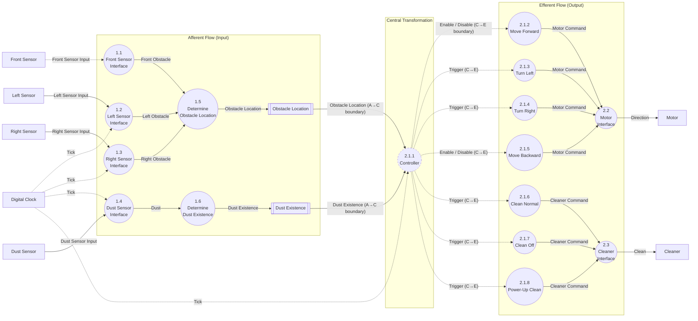

# Transform Analysis

Sources: `docs/preliminary_requirements.md` (R1–R7), `docs/clarifications.md` (C1–C29), `artifacts/SA/event_list.md` (Rev 3), `artifacts/SA/context_diagram.md` (Rev 3), `artifacts/SA/DFD/dfd_level_0.md` – `dfd_level_3.md`, `artifacts/SA/DFD/dfd_level_4_fsm.md`, `artifacts/SA/data_dictionary.md` (Rev 8), `artifacts/SA/process_specification.md` (Rev 8), `artifacts/SA/sa_consistency_report.md`.

## 1. Objective
Identify the Afferent Flow, Central Transformation and Efferent Flow in the approved DFD hierarchy. The analysis is based on the leaf processes: Level 2 primitives 1.1–1.6, 2.2 and 2.3, and Level 3 processes 2.1.1–2.1.8. The boundaries found here are the basis for the first-level factoring of the Structure Chart (`structure_chart.md`).

## 1.1 Review of SA Artifacts (Step 1)

### Functions and their relationships

| Level 1 function | Leaf processes | Relationship |
|---|---|---|
| 1 Obstacle & Dust Detection | 1.1, 1.2, 1.3, 1.4, 1.5, 1.6 | Writes the **Obstacle Location** and **Dust Existence** stores |
| 2 Cleaner & Motor Control | 2.1.1–2.1.8 (decomposition of 2.1), 2.2, 2.3 | Reads both stores on Tick. Sends **Direction** to the Motor and **Clean** to the Cleaner |

Processes 1 and 2 share no flow except the two stores (DFD Level 2). The front interrupt (C1) writes the store at any time. The Controller reads the store on Tick (C20). The stores decouple the two.

### Data processes and control processes

| Kind | Processes | Source |
|---|---|---|
| Control process | 2.1.1 Controller (the only one) | `dfd_level_3.md`; FSM in `dfd_level_4_fsm.md` |
| Data process, interrupt-driven | 1.1 Front Sensor Interface | C1 |
| Data process, periodic (Tick) | 1.2, 1.3, 1.4 | C2, C17 |
| Data process, store writer | 1.5, 1.6 | PS 1.5, 1.6 |
| Data process, continuous (Enable/Disable) | 2.1.2 Move Forward, 2.1.5 Move Backward | C24 |
| Data process, one-shot (Trigger) | 2.1.3, 2.1.4, 2.1.6, 2.1.7, 2.1.8 | C25 |
| Data process, compare-and-send | 2.2 Motor Interface, 2.3 Cleaner Interface | C12 |

### Input and output flows

| Flow | Kind | From → To |
|---|---|---|
| Front Sensor Input | Control (interrupt), Boolean | Front Sensor → 1.1 |
| Left / Right / Dust Sensor Input | Data (periodic), Boolean | Sensors → 1.2 / 1.3 / 1.4 |
| Tick | Control (temporal) | Digital Clock → 1.2, 1.3, 1.4, 2.1.1 |
| Front / Left / Right Obstacle | Data, Boolean | 1.1 / 1.2 / 1.3 → 1.5 |
| Dust | Data, Boolean | 1.4 → 1.6 |
| Obstacle Location, Dust Existence | Data (store write / read) | 1.5, 1.6 → stores → 2.1.1 |
| 9 control signals (Enable / Disable / Trigger) | Control | 2.1.1 → 2.1.2–2.1.8 |
| Motor Command | Data, Enum | 2.1.2–2.1.5 → 2.2 |
| Cleaner Command | Data, Enum | 2.1.6–2.1.8 → 2.3 |
| Direction, Clean | Data (output command) | 2.2 → Motor, 2.3 → Cleaner |

### Controller behaviour (FSM)
- 5 states: FwdNormal (initial), FwdPowerUp, TurnLeft, TurnRight and MoveBackward.
- 25 transitions, T1–T25. Event: Tick only, plus Init.
- Guards on F, L, R and D, and on three counters: `turnDone` = turn count 3, `upDone` = power-up count 3, `revMin` = reverse count ≥ 3.
- Actions are only the 9 control signals. They are issued only on a transition (C26), in a fixed order (FSM Issue 4).

### Dependencies and interfaces
- Each Tick, sensing (1.2–1.6) comes before the Controller decision (C20).
- 1.1 runs asynchronously and writes only the front part of Obstacle Location.
- 2.1.2–2.1.8 have no Tick input. All timing is inside 2.1.1 (Level 3 Signal Type Rules).
- 2.2 and 2.3 each keep the last value sent (C12). They have no separate start-up send (C27).

## 2. Transform Regions

### Afferent Flow (Input)
These processes receive raw sensor input and turn it into the most abstract input: the stored obstacle situation and dust status that the Controller reads.

| Process ID | Process Name | Input | Output |
|---|---|---|---|
| 1.1 | Front Sensor Interface | Front Sensor Input (interrupt, C1) | Front Obstacle |
| 1.2 | Left Sensor Interface | Left Sensor Input, Tick | Left Obstacle |
| 1.3 | Right Sensor Interface | Right Sensor Input, Tick | Right Obstacle |
| 1.4 | Dust Sensor Interface | Dust Sensor Input, Tick | Dust |
| 1.5 | Determine Obstacle Location | Front Obstacle, Left Obstacle, Right Obstacle | Obstacle Location (store write) |
| 1.6 | Determine Dust Existence | Dust | Dust Existence (store write) |
| store | Obstacle Location | written by 1.5 | read by 2.1.1 |
| store | Dust Existence | written by 1.6 | read by 2.1.1 |

Rationale:
- 1.1–1.4 only acquire Boolean values and pass them on unchanged (C3).
- 1.5 and 1.6 only assemble the values and store them. They make no decision (PS 1.5, 1.6: "Do not otherwise interpret the values").
- None of these processes contains any control rule (C4, C9, C13, C15 belong to 2.1).

### Central Transformation (Process)
This process turns the abstract input into decisions. All requirement logic is here.

| Process ID | Process Name | Input | Output |
|---|---|---|---|
| 2.1.1 | Controller (FSM, `dfd_level_4_fsm.md`) | Obstacle Location (F, L, R), Dust Existence (D), Tick | Enable / Disable "Move Forward"; Enable / Disable "Move Backward"; Trigger "Turn Left", "Turn Right", "Clean Normal", "Clean Off", "Power-Up Clean" |

Rationale: 2.1.1 is the only control process. It holds every decision rule:
- obstacle avoidance with left first (R3, R4, C4)
- 3-tick turn (C5)
- reverse for at least 3 ticks (C9)
- 3-tick power-up with no restart and cancellation by an obstacle (C6, C11, C14)
- ignoring side-only obstacles and dust where required (C10, C13, C15, C29)

It also holds all timing, the current movement and the cleaning mode (DD Section 4.6). Its input is the most abstract form of the input, and its output is the most abstract form of the output: control signals that name *what* to do, not the values sent.

### Efferent Flow (Output)
These processes turn the Controller's control signals into the output commands, and deliver them to the actuators.

| Process ID | Process Name | Input | Output |
|---|---|---|---|
| 2.1.2 | Move Forward | Enable / Disable "Move Forward" | Motor Command = Forward (once on Enable, C24) |
| 2.1.3 | Turn Left | Trigger "Turn Left" | Motor Command = Turn Left (C25) |
| 2.1.4 | Turn Right | Trigger "Turn Right" | Motor Command = Turn Right (C25) |
| 2.1.5 | Move Backward | Enable / Disable "Move Backward" | Motor Command = Backward (once on Enable, C24) |
| 2.1.6 | Clean Normal | Trigger "Clean Normal" | Cleaner Command = clean_on (C25) |
| 2.1.7 | Clean Off | Trigger "Clean Off" | Cleaner Command = clean_off (C25) |
| 2.1.8 | Power-Up Clean | Trigger "Power-Up Clean" | Cleaner Command = clean_up (C25) |
| 2.2 | Motor Interface | Motor Command | Direction → Motor (only on change, C12) |
| 2.3 | Cleaner Interface | Cleaner Command | Clean → Cleaner (only on change, C12) |

Rationale:
- 2.1.2–2.1.8 make no decision. Each one maps one control signal to one fixed command value (DD Section 4.4: "each producer makes exactly one value"). This is output generation.
- 2.2 and 2.3 do the last output step: the C12 filter and delivery to the terminator. They are the "motor control" and "cleaner control" of the efferent branch.
- 2.1.2–2.1.8 are drawn inside 2.1 at Level 3. Placing them in the efferent region is still correct, because a region is decided by what a process does, not by its DFD parent.

## 3. Transform Boundaries

- **Afferent-to-Central Boundary:** between the two data stores and 2.1.1. The boundary is crossed by the store reads that 2.1.1 makes on each Tick, after sensing (C20).
- **Central-to-Efferent Boundary:** between 2.1.1 and the action processes 2.1.2–2.1.8. The boundary is crossed by the 9 control signals.
- **Boundary Data Flows:**
  - Inbound: **Obstacle Location** (Front Obstacle + Left Obstacle + Right Obstacle) and **Dust Existence**, both read from their stores.
  - Outbound: none. 2.1.1 produces no data (`dfd_level_3.md`: "It sends no data").
- **Boundary Control Flows:**
  - Inbound: **Tick** (the only event of 2.1.1).
  - Outbound: **Enable / Disable "Move Forward"**, **Enable / Disable "Move Backward"**, and **Trigger** "Turn Left", "Turn Right", "Clean Normal", "Clean Off" and "Power-Up Clean".

Rationale for each boundary:
1. **Afferent → Central.**
   - The stores are the point where input stops being "sensor data" and becomes "the situation the decision is based on".
   - On the input side of the boundary, no value is interpreted. On the Controller side, every value is used as a guard (F, L, R, D).
   - The stores also mark a timing boundary. 1.1 writes at interrupt time (C1). 1.2–1.6 write on Tick before the decision. 2.1.1 reads on Tick after sensing (C20). So the input branch and the central transform run at different moments, and the boundary must sit at the store.
2. **Central → Efferent.**
   - On the Controller side are the decisions and timing. On the output side, each process produces a fixed value with no condition.
   - The boundary flows are control signals, not data. So the efferent branch is *started* by the central transform when a transition happens (C26). It is not fed with a data value on every Tick.
   - This affects the Structure Chart: the efferent modules are called by the Controller, not by Main (see `structure_chart.md`, Section 3).
3. **Inside the efferent branch** there is a second step between 2.1.2–2.1.8 and 2.2/2.3, carried by Motor Command and Cleaner Command. It is not a transform boundary, because both sides are output processing. It does separate the many producers from the two shared delivery processes, which become reusable library modules in SD (C12).

## 4. Transform Analysis Diagram

Data flows are solid. Control flows are dashed. The two stores are drawn inside the afferent region because their writers (1.5, 1.6) are afferent. The arrows that cross a subgraph border are the boundary flows of Section 3.

### Process-to-region map

| Process | Region | Basis |
|---|---|---|
| 1.1, 1.2, 1.3, 1.4 | Afferent | Sensor interfaces; values passed on unchanged (C3) |
| 1.5, 1.6 (+ stores) | Afferent | Input processing; assemble and store, no interpretation |
| 2.1.1 | Central | Only control process; all decisions and timing |
| 2.1.2–2.1.8 | Efferent | Map one control signal to one fixed command value |
| 2.2, 2.3 | Efferent | Send-on-change filter and delivery to actuator (C12) |
| 0, 1, 2, 2.1 | — (non-leaf) | Decomposed. Their behaviour is carried by the leaves above |

All 17 leaf processes are mapped. Each is in exactly one region. None was added or removed.

## 5. Analysis Rules (check)

| Rule | Result |
|---|---|
| Identify transform regions from actual DFD processes | Yes. Only the processes in DFD Levels 2–3 are used |
| Preserve process names and identifiers | Yes. Names and numbers match `dfd_level_2.md` and `dfd_level_3.md` |
| Distinguish data flows from control flows | Yes. Section 1.1 and the diagram use solid lines for data and dashed lines for control, as in the DFDs |
| Identify boundaries using actual DFD connections | Yes. A→C uses the two store reads and Tick. C→E uses the 9 dashed arrows of Level 3 |
| Do not introduce unsupported processes | Yes. No process, flow or store was added |
| Do not confuse data flow with module calls | Yes. This document describes flows only. Calls are defined in `structure_chart.md`, where the direction of a call can differ from the direction of a flow (for example, the Controller *calls* the store module to read Obstacle Location) |
| Explain the rationale for each classification | Yes. See Section 2 and the region map |

## 6. Consequences for the Structure Chart

These follow directly from the boundaries. They are applied in `structure_chart.md`.

1. **Main** is the root. It calls `rvc_startup()` once, then `rvc_tick()` on each Tick. These are in the RVC System module. On each Tick, `rvc_tick()` calls the afferent coordinator first and then the Controller (C20). This split was requested at SD approval (2026-11-08).
2. The **Controller** module (2.1.1) is the central transform. It calls the store modules to get its input. It calls the efferent action modules only on an FSM transition (C26).
3. The **efferent** modules (2.1.2–2.1.8) are called by the Controller, not by Main. The boundary flows are control signals issued on transitions. They are not a data value that Main could pass on every Tick.
4. **1.1 Front Sensor Interface** is an interrupt entry point (C1). It is not called by Main. It writes the Obstacle Location module directly.
5. **2.2 Motor Interface** and **2.3 Cleaner Interface** are shared by several callers (4 and 3). They become library modules that apply C12.
